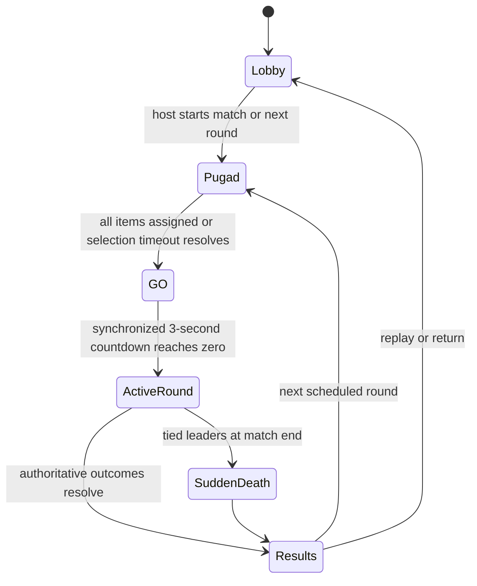

# PC Host, Android Clients, and Live Placement

**Status (2026-10-20):** NLB-P01's local action/authority foundation, NLB-P02's opt-in PC LAN lobby, and the NLB-P05 offline opt-in live-build route have implementation evidence. P02 provides raw ENet session hosting, IPv4 UDP discovery, one-use invitation proof, compatibility checks, host approval, lobby seat assignment/readiness and teardown; it does not start network gameplay. The scheduled P12 `Pugad → Place → Play` route remains the default and fallback. The opt-in `-- --match-route=offline_live_build` route uses `Lobby → Pugad → GO → active Play/build → results → next round`. P02 engineering evidence is in [NLB-P02](evidence/nlb/p02/README.md); real Wi-Fi/no-internet LAN and abusive-flood acceptance remain open. P05-T01 passes the opt-in route gate; broad P05 safety/compatibility acceptance remains open. **Release status:** separately gated development track; not required for the 2026-10-21 feature freeze or 2026-10-25 submission. See the [NLB-P01 verification record](evidence/nlb/p01/verification-2026-10-19.md).

This specification is linked from [GDD](GDD.md), [PRD](PRD.md), [legacy tracker](PHASETASK.md), [new implementation tracker](PHASETASK_NETWORKED_LIVE_BUILD.md), and [documentation index](INDEX.md).

## 1. Product intent and status vocabulary

Tilaok! becomes a PC-hosted party platformer that lets Android phones join as full game clients over the same Wi-Fi/LAN. The PC runs the match and may show the shared arena to spectators. A PC host takes a player seat only when a local keyboard or gamepad joins. Every phone renders the same arena state and supplies input for one assigned chicken. Phones are not video-stream viewers or buttons-only remotes. PC and Android share one Godot project and one gameplay rules implementation.

This track preserves the current 2–4-player total, existing scores, modes, items, maps, cultural and asset rules, and original-work requirements. It adds no internet matchmaking, relay, account, persistent save, or host migration. Human production responsibilities for final art/audio remain unchanged. Standing AI-assisted programming authorization applies to approved future code tasks; record actual assistance in `AI_USAGE.md` and Form 03 preparation.

Use these labels consistently:

| Label | Meaning |
|---|---|
| **CURRENT OFFLINE BASELINE** | Behavior implemented in the existing executable and supported by current evidence. |
| **APPROVED TARGET** | Direction confirmed by the user for this future workstream; not yet implemented. |
| **APPROVED TARGET RULE** | Concrete rule approved as part of the user-approved plan; implementation and verification status is recorded per task. |
| **FUTURE / NOT RUN** | Work or verification not yet performed. |

The user-confirmed choices are: PC-hosted authority; same-Wi-Fi clients; installed Android app; live shared arena rendering; supported PC keyboard/gamepad seats; no separate placement period; shared synchronized three-second GO; movement, objectives, and placement open together; current four-seat maximum; host may be spectator; and item deployment continues during the active round. They also confirmed the shared-arena phone camera, dedicated build mode, host-only global pause, host-receipt placement order with rotating true-tie priority, the existing extra Lagsanay opening freeze (the frozen taya may build while unable to move or take damage), lobby-only new-player join, a 60-second reclaim grace with round forfeit after expiry, and LAN-discoverable Lobby ID plus QR and manual IP fallback. The offline P05 implementation exercises only the transport-free subset; it does not implement clients, replication, host/client pause, or reclaim.

## 2. Round flow and gameplay rules

**APPROVED TARGET** flow:

**APPROVED TARGET RULE — Pugad:** retain the existing approximately eight-second selection window. End early when every participating seat owns one assigned item. At timeout, the host assigns remaining eligible eggs randomly, then starts one shared three-second countdown only after every seat has an assignment. If no valid assignment can be made, do not enter GO; return to host-controlled lobby recovery with a visible reason. Record the seed and assignment in the authoritative round state.

**APPROVED TARGET RULE — active construction:** each player receives only the item selected for that round. At GO, the round, movement, objectives, and existing stage items start together. Players can enter build mode and deploy the selected item at any time while eligible. The host commits a successful edit once and consumes the item; a rejected request retains it and returns an actionable reason. No extra item or mid-round shop is added. An unused item is discarded at round end; never auto-place it. Eliminated or secured players cannot place. Existing construction persistence/removal rules continue.

**Lagsanay:** the synchronized GO starts the event and lets eligible non-taya players move/build. Keep the current opening taya freeze/head start for its existing duration after GO; the taya cannot move or take damage during that freeze. Do not restart or duplicate the freeze on a client. Passing, event clocks, scoring, exact terminal ordering, trap credit, Barya eligibility, and match outcomes remain host decisions and retain current GDD semantics unless a separately approved change says otherwise.

**Sudden Death:** current match design starts no new Pugad. Reuse its persisted stage and current sudden-death rules; no new selection or placement item appears. Host replay creates a new match using the existing reset semantics. Returning to Lobby tears down the session and permits a fresh host session.

## 3. Roles, authority, and session lifecycle

### 3.1 Host and client ownership

| System | PC host/server | Android client | PC local seat |
|---|---|---|---|
| Session, pairing, seat registry, phase, round and compatibility | Owns and validates | Requests and displays approved state | Uses same seat/action contract |
| Movement, collision, construction, item physics, hazards and event simulation | Sole authority | Renders replicated state; may predict local presentation | Host samples local input into the same simulation |
| Pugad, item ownership, RNG, timers, pickups, terminal outcomes, score and match transitions | Sole authority; seeded state replicated | Requests; displays acknowledgments/results | Same rules and authoritative ledger |
| Camera/UI/input | Shared spectator arena; may also display a local chicken | Same arena framing in landscape; local touch/input for assigned seat | Existing per-seat keyboard/gamepad handling |

No client may declare its position, collision result, successful placement, elimination, item pickup, event result, RNG decision, or score authoritative. Host validates every request and runs the sole rules implementation. Do not use deterministic physics lockstep across PC and Android.

Local input is an action/seat adapter. Convert keyboard, gamepad, and phone gestures to the same logical actions and edge/held-state records; simulation reads those records independent of device kind and local input phase. Maintain a local-only adapter/profile so existing offline play remains usable. Host keyboard/gamepad actions enter the same simulation boundary as received client input.

The first client view is landscape and shows the shared stage framing used by the PC. No player receives a follow-camera or private-information advantage. Client-local interpolation/prediction is presentation only: reconcile it to the last authoritative host state, show rejected placement feedback, and never label an unaccepted ghost as committed.

### 3.2 Session creation, discovery, pairing, and seats

The PC host explicitly creates and shuts down an opt-in session; offline play remains the default. P02 uses Godot 4.7.2 raw `ENetConnection`/`ENetPacketPeer` with channel 0 reliable control packets, as specified in the versioned [P00 v1.1 clarification](evidence/nlb/p00/protocol-measurement-contract-v1.1.md). SceneMultiplayer RPC framing and object decoding are disabled. P02 does not enable gameplay message families. The wire major is 1 and minor is 1. The implementation has been exercised with local host/client processes; real Wi-Fi connectivity and firewall behavior remain unverified. The host UI displays the chosen eligible IPv4 interface, actual ports and discovered interface status. Manual IPv4/IPv6 client address entry remains available if UDP discovery is blocked.

**Lobby discovery:** the host advertises a bounded beacon over its selected local IPv4 interface. Lobby ID queries look up the public identifier and grant no authority. A QR invite contains the session ID, host address, ENet port, protocol/content digest and a short-lived access code; the client transmits the credential only in the challenge proof. Manual address and Lobby ID lookup require the access code separately. Host approval precedes assignment. The implementation uses no external discovery, relay, DNS, account service, internet dependency or persisted session state. Beacon expiry is three seconds; Wi-Fi client isolation and real-LAN discovery remain unverified. Manual address remains the fallback.

The four player seats remain the global maximum and require at least two participants to start, matching current rules. The host consumes no seat unless a local input device joins. One peer owns one seat and one active input stream. Host assigns identities; client-provided colors, seat numbers, ownership claims, and names are untrusted. New players may join only before the match starts. A reconnecting original player is reclaiming a reserved identity, not a new late join.

At pairing, validate protocol version, game build/content manifest version, map/item compatibility, and required data schema before admission. Report a player-readable mismatch and reject incompatible clients without changing match state. Ready/start belongs to the host; all required seats and content must be ready before the round begins.

### 3.3 Reconnect, background, pause, and shutdown

When a client backgrounds or loses connection, the host immediately substitutes neutral input and clears any held/pressed/aim state so movement or jump cannot stick. The game continues. Keep the original seat and score reservation for 60 seconds. A valid reconnect must prove the invitation/reclaim token and reclaim the same identity. Reclaim during a round restores that seat only at a safe simulation boundary and after a current authoritative snapshot. If the 60-second grace expires during an active round, the host commits a disconnect elimination for that round (no Patibong credit); keep the identity reserved and allow that player to reclaim at a later round boundary. At Pugad, host timeout assignment applies to any unclaimed item.

Only host input can globally pause simulation. A client pause opens its local overlay and does not stop the host. When host pauses, every connected view freezes at the same authoritative pause transition; resume follows the host. Pause clocks, event clocks, physics, and simulation timers freeze together. Focus loss on a client clears input and uses neutral state; it does not create a global pause. Document what an app that is suspended by Android can and cannot report to the host; rely on input timeout and disconnect detection rather than assuming a background callback arrives.

Host shutdown closes the session, releases the peer, clears ephemeral session IDs/tokens and stops accepting connections. Clients show host loss and return to their title/lobby screen. No host migration or authoritative continuation on a phone is supported. On replay, session teardown precedes a new session identity; on return to Lobby, clear peer-to-seat ownership and pending protocol messages while preserving no network state on disk.

## 4. Versioned protocol contract

The reviewed wire and recovery contract is maintained in [NLB-P00 protocol and measurement contract v1](evidence/nlb/p00/protocol-measurement-contract-v1.md), with the implemented P02 framing and family clarification in [wire minor 1](evidence/nlb/p00/protocol-measurement-contract-v1.1.md). Together these are the canonical definition of message envelopes, fields and bounds, authentication state, channels, rate limits, ordering, duplicate/stale behavior, validation results, snapshot/delta recovery, and replicated-state coverage. Do not copy their tables into this specification.

Frozen product requirements remain: host authority; host-assigned peer/seat ownership; no client-declared position, collision, placement, RNG, event outcome, or score; shared logical actions; no deterministic physics lockstep; three separate delivery channels; lobby-only admission; snapshot acknowledgment before client input; bounded validation and recovery; and no network state persisted to disk. A future engine/API limitation that requires a change must update the contract and review evidence before implementation.

P00 contract defaults resolve two ambiguities in the initial proposal. Axis inputs outside the normalized finite range are rejected, not clamped. The 900-byte cap counts the full serialized application frame (envelope plus payload); transport/network overhead and retransmissions are measured separately. The 64 KiB logical snapshot cap is retained and has an explicit chunk and failure contract. These are protocol decisions for the separately gated implementation, not runtime claims.

## 5. Mixed-device controls and phone presentation

Landscape phone view shows the same arena, global objective/event, timer, scores, player markers, and placement outcome as the PC. The phone labels its assigned player with number/shape plus color. Use device safe areas, notches, aspect-ratio letterboxing/camera fitting, minimum 44 dp touch targets (proposed floor), and UI that keeps fingers off critical objective/timer cues. Aim conversion must use the active camera transform and map to the 64-pixel logical grid; show footprint, rotation, effect/sweep, protected regions, and a text reason alongside shape/outline. Never cover the target ghost or a danger tell with a finger.

**Touch matrix (target):**

| Context/action | Phone | Keyboard equivalent | Gamepad equivalent |
|---|---|---|---|
| Join / ready / lobby start | Screen buttons | Existing join/ready/confirm | Existing confirm button |
| Pugad item choice | Tap an egg; selected state and text marker | Existing navigation + claim | Existing D-pad/stick + confirm |
| Move / jump / sneak / glide | Left movement zone; jump and sneak are distinct controls; hold-jump glide follows current rules | Existing assigned K1–K4 actions | Existing left stick/D-pad, jump and sneak mapping |
| Enter/leave build mode | Dedicated Build toggle; does not pause world | New explicit build-mode action, not jump/cheer | Dedicated mapped button, not jump/cheer |
| Aim item | Separate right-side aim pad; movement zone remains active | Dedicated aim directions/control group separate from locomotion | Right stick for aim; left stick keeps locomotion |
| Rotate / confirm / cancel | Distinct right-side buttons | Existing rotate/confirm where conflict-free; explicit cancel/back; never repurpose jump or cheer | Preserve existing rotate/confirm/back bindings; no silent jump/cheer alias |
| Pause / cheer | Pause menu button; spectator cheer remains a separate eligible control | Existing system pause and cheer action | Existing Start/pause and cheer mapping |
| Results / menus | Large separate ready/continue/back controls | Existing navigation and confirm/back | Existing navigation and confirm/back |

No action edge can be consumed by two contexts. Build mode leaves the world running and locomotion input active. The aim area controls only the ghost and cannot also set movement. Confirmation sends one stable request ID; repeat taps reuse/dedupe that request until acknowledgment. Cancel hides the local preview and preserves the selected item. Closing build mode does not silently confirm. PC keyboard layouts and physical gamepad actions keep their existing meanings; map all new controls in the control legend and Library.

## 6. Authoritative live-placement and migration rules

### 6.1 Commit and conflict rules

The old Place-phase resolver validates all edits against a shared frozen snapshot and stable seat order. It cannot validate live actor/hazard state. **APPROVED TARGET:** every edit validates against the latest host world at its authoritative commit boundary. Queue each validly framed request for the next fixed simulation boundary in host receive order. If requests have indistinguishable host receipt ordering at that boundary, rotate starting seat priority by round number and sort remaining ties by seat. Earlier client confirmation time has no authority. This replaces the old persistent lower-seat priority and does not claim equal network delay.

Before commit, recheck: session/round/stage version; peer-seat ownership; selected item and one-use state; living/unsecured status; placement reach/range; legal tile/world bounds and rotation; persistent/transient caps; existing stage and pending edits; current player bodies plus protected clearance; spawn/goal/event protected regions; moving-object footprints and bounded sweeps; projectile lanes/effects where relevant; and safe insertion/removal response. Recompute the result server-side; client green ghost is only a guess. An accepted response names authoritative item/entity ID, committed transform, stage version, activation time and tell/grace. A rejected response includes a stable player-facing reason and leaves inventory intact.

New solid insertion cannot crush/trap a chicken, close every safe egress around a currently overlapping player, push into a lethal region, or pin a captive. Reject if no safe displacement/existing contract can guarantee clearance. New lethal/stun regions require validated safe clearance and their tell/grace starts at commit, not at round start. New moving paths must have bounded visible sweeps and cannot sweep through a live protected body at activation. Solids keep their current projectile-blocking semantics. Items activate only after their approved tell/grace, even when added late in Play.

Same-time world events and placement use one deterministic host boundary order: resolve already queued terminal events using existing P12 terminal-order rules; freeze the current authoritative query state; resolve placement requests by receipt/tie policy and current safety; commit one edit and increment stage version; update removals/support; publish result; schedule any hazard activation; continue the next physics step. A round-end commit closes placement admission first, rejects pending requests with “Round ended”, then commits final outcome/score once. No placed edit retroactively cancels an already committed terminal outcome.

### 6.2 Special-case migration matrix

| Existing behavior | Live-round target contract |
|---|---|
| Walis Cleanup | Select only currently removable, previously committed player items in its live preview. Revalidate target IDs, bounds, support dependents, and protected exclusions at commit. Remove as one edit; never delete newly pending same-boundary edits or base/spawn/goal/event protection. Apply existing safe support-release rule; no Play hazard or Patibong. |
| Explosives / same-step placements | Remove the old “same Place snapshot blast” rule because no shared Place batch exists. The explosive itself is a validated edit. Its normal host-timed fuse/tell affects only objects present and eligible at detonation; later/earlier accepted placements follow authoritative entity age and blast semantics. Never silently erase an unacknowledged edit. |
| Lethal/stun zones beside live players | Reject insertion that overlaps protected body clearance or creates an unavoidable immediate hit. Start tell/grace on host commit; collision and outcome attribution stay host-authoritative. |
| Projectiles / moving paths | Spawn, path phase, collision and impact are host-owned and replicated. Validate bounds, lane/sweep and actor clearance at commit and activation; late placement gets its own warning/grace. |
| Collapse/physics blocks | Host owns countdown, support, collapse and reset. A live solid cannot crush/pin occupants; resolve via safe displacement or reject. Replicate actual state and stage-versioned removal. |
| Barya | Preserve one round-scoped nonpersistent coin, offer/pickup/drop/recovery, host arbitration, carried-through-capture behavior, scoring exception and cleanup. Server resolves nearest pickup and drop cell; no client award or client pickup authority. |
| Rising-wave support | Evaluate actual current host support on the same evaluation tick after accepted terrain/support removals and insertions. Replicate selected seeded wave and authoritative result. No client-only support can pass. |
| Freeze / Hug while building | Freeze continues to evaluate current movement/jump intent. Build-mode aim/rotate/confirm are separate and do not become movement intent. Hug evaluates host-owned chicken contacts; build controls do not create contacts or remove a player from eligibility. |
| Round end / pending edits | Host closes the request gate before terminal score commit. Pending requests receive deterministic rejection; accepted commits before closure persist and replicate exactly once. |
| Sudden Death | No new Pugad exists, so no selected item or placement request is available. Reuse persisted construction and existing sudden-death event/outcome rules. |

Keep current scoring values, race suppression/Barya exception, Lagsanay placements, P12 terminal order and event semantics. Any proposed behavior that would change these contracts is blocked for separate design approval; this documentation does not change them.

## 7. Compatibility, migration, and rollback

Use one repository, shared Godot gameplay scripts/scenes/data, and host/client launch/export roles. Keep networking transport, input source, session coordination, authoritative simulation, snapshot serialization, and presentation boundaries explicit so local play can run without a peer. Do not fork gameplay rules for Android. Compatibility matrix must enumerate every existing mode, map, item/variant, event stack, Barya path, and special lifecycle (including sudden death); unsupported cells remain disabled with a reason until their own verification passes.

Migration starts by separating the existing offline implementation/evidence from the target architecture. Preserve the existing local route and input profile as a fallback while refactoring shared actions/seat ownership. Implement receiver/host validation before dependent phone senders. Integrate one PC + one Android + one local PC end-to-end slice before scaling device counts. Do not add persistent session/game saves. Network schema starts versioned; incompatible builds are rejected, and full snapshots recover in-memory state. A migration never retroactively upgrades the current offline executable's status.

Rollback disables the opt-in host/client route and live-build mode while leaving the existing offline Pugad → Place → Play route available. No schema/data migration is needed because this track introduces no disk progression or saved multiplayer state. Keep new tasks separate from the P00–P19 history; do not rewrite prior evidence, checkboxes, IDs, or totals.

## 8. Performance, verification, and gates

The targets remain **PROPOSED / UNMEASURED**. The complete definitions, units, endpoints, duration/load, statistic, instrumentation, device identity, byte accounting and future pass criteria are in the [P00 measurement contract](evidence/nlb/p00/protocol-measurement-contract-v1.md#7-measurement-contract). No phone minimum or battery/thermal release threshold is selected here.

Required future evidence: automated protocol/authority and malformed-request cases; actual exported Windows host and installed Android APK; a physical phone joining; 2/3/4-phone and mixed keyboard/gamepad/phone combinations; local-only fallback; injected loss/jitter/delay/reorder/duplicates; stale/full-resync; malformed/spoofed/rate-limited requests; late join rejection; reclaim identity; background/screen lock/Wi-Fi loss; host shutdown; edit conflict, moving-player clearance, support changes, every mode/stack/item/map and exact scoring/Barya; ten complete match/replay cycles; crowded-stage performance, touch readability and novice sessions. Synthetic clients are engineering evidence only, not physical-device or human-play evidence. Record build/revision, engine, date, profile/seed, player count, actual devices/input or synthetic clients, network conditions, procedure, expected/actual, evidence, and actual reviewer. Mark each check PASSED / FAILED / COULD-NOT-RUN with a reason.

The tracker defines the ordered gates and task evidence in [PHASETASK_NETWORKED_LIVE_BUILD.md](PHASETASK_NETWORKED_LIVE_BUILD.md). Passing documentation checks does not pass any gameplay/network/mobile task. This track is separately scheduled after release obligations are reviewed; its work and budgets do not revise the October freeze or deadline automatically.

## 9. Engine and tool facts

Historical environment note (2026-10-19, prior inspection): checkout `main` at `761e3fc`; Godot `4.7.2.stable.official.ed1daf0bf`; Java 17; Android SDK/ADB and 4.7.2 export templates; no connected Android device; Windows preset only; no network implementation. This note records what that earlier inspection observed.

Reverified for NLB-P00 on 2026-10-19: checkout `main` at `51855777d3cd37db049051e7e86374932bc8fceb`; the PATH launcher is Godot 4.6.3, and the user's selected executable at `D:\Downloads\Godot_v4.7.2-stable_win64_console.exe` is Godot `4.7.2.stable.official.ed1daf0bf`. Java 17 and the Android SDK/ADB are available; the SDK has installed Android platforms/build-tools, but `adb devices -l` found no device. The project has only a Windows Desktop export preset. No network transport/RPC implementation was found. No packages, export settings, firewall rules, or APK were changed. Full tool details and offline test results are in the [dated baseline](evidence/nlb/p00/baseline-2026-10-19.md) and [P00 review](evidence/nlb/p00/review-2026-10-19.md).

## 10. Decisions and deferred scope

Approved by the documentation plan: target product direction and user-confirmed choices enumerated in §1. P02 implements the PC host lobby and admission boundary only; P03 Android work, P04 gameplay transport/replication and later phases remain future work. P02 is trusted-LAN protocol traffic without encryption. Runtime evidence and unrun checks are tracked per task. Later implementation must not alter scoring, terminal ordering, event meanings, four-seat cap, local fallback, or original-work/asset responsibilities without separate approval. Internet matchmaking, relay, host migration, account systems, persistence, video streaming, a phone-only rules implementation, and player count expansion are out of scope.
