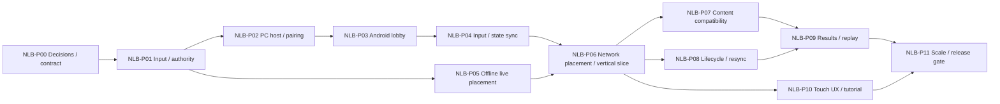

# Tilaok! — PC Host, Android Clients, and Live Placement Tracker

**Status (2026-10-20):** NLB-P00 documentation, P01 local action/authority, the P02 PC LAN lobby, P05 offline opt-in live-build implementation, and partial P03 Android lobby/export work have engineering evidence. P02 exit passes (3/3): local process admission, malformed-frame abuse thresholds, lifecycle checks, and the user-confirmed physical no-internet phone-hotspot join. P03 T01's Android debug export and package inspection pass (1/3 tasks); T02 Android runtime/host compatibility and retained T03 physical-device evidence remain open. P03 entry is no longer held by P02. P05-T01 passes its own route acceptance; P05-T02/T03 remain open against their broader safety and regression criteria. Network gameplay and P04/P06–P11 remain separately gated tasks. **Spec:** [NETWORKED_LIVE_BUILD.md](NETWORKED_LIVE_BUILD.md). **Legacy history:** [PHASETASK.md](PHASETASK.md) P00–P19 is preserved and is not renumbered or included in these counts.

## How to use this tracker

- Stable task IDs use the `NLB-Pxx-Tyy` namespace. Never renumber a task; add a new ID when scope changes.
- Every task is independently checked only after its acceptance and evidence are complete. `NOT RUN` is the initial actual result for every task.
- `IMPLEMENT` records implementation work; `VERIFY` records a distinct verification gate. Synthetic evidence does not satisfy physical-device or human-play acceptance.
- Requirements are `NLB-REQ-001` through `NLB-REQ-020`; the traceability map below links each requirement to one or more tasks.
- A phase may advance only when its dependencies and phase exit criteria have evidence. Unsupported compatibility cells remain disabled and documented.

## Phase summary and counts

Counts are derived from the task records in this document. Current: **12 phases, 36 tasks; 11/36 checked; 25 TODO; actual results PASSED 11, COULD-NOT-RUN 4, NOT RUN 21.** NLB-P03 and P05 are partial; P02 passes 3/3, including the user-confirmed physical no-internet hotspot join. P03 T01 export/package acceptance passed, while T02 Android runtime/compatibility and T03 retained physical-device evidence remain open. P03 entry is no longer held by P02. P05-T01 passed its own offline opt-in flow acceptance, while P05-T02/T03 evidence remains incomplete. Legacy P00–P19 counts remain only in `docs/PHASETASK.md`.

| Phase | Goal | Tasks | Dependencies | Status |
|---|---|---:|---|---|
| NLB-P00 | Decisions, baseline, protocol requirements | 3 | Approved docs | PASSED (3/3) |
| NLB-P01 | Local action/seat abstraction and authority boundary | 3 | P00 | PASSED (3/3) |
| NLB-P02 | PC host session, discovery, pairing, compatibility | 3 | P01 | PASSED (3/3) |
| NLB-P03 | Android export/install and physical phone lobby join | 3 | P02 | PARTIAL (1/3) |
| NLB-P04 | Input transport, authoritative simulation and shared view | 3 | P03 | TODO |
| NLB-P05 | Offline active-placement flow and safe commit | 3 | P01 | PARTIAL (1/3) |
| NLB-P06 | Network placement replication and vertical slice | 3 | P04, P05 | TODO |
| NLB-P07 | All current content/modes/stacks compatibility | 3 | P06 | TODO |
| NLB-P08 | Pause, background, disconnect/reclaim, resync | 3 | P06 | TODO |
| NLB-P09 | Results, sudden death, replay and teardown | 3 | P07, P08 | TODO |
| NLB-P10 | Touch UX, tutorial, accessibility, mixed-device parity | 3 | P06 | TODO |
| NLB-P11 | Scale, fault/performance QA, packaging and release gate | 3 | P09, P10 | TODO |

**Status totals:** TODO 26 · BLOCKED 0 · DEFERRED 0 · IMPLEMENT 24 · VERIFY 12 · checked 10. Result totals: PASSED 10 · FAILED 0 · COULD-NOT-RUN 5 · NOT RUN 21. Recalculate from records after every update; do not copy forward stale totals.

## Requirements

| ID | Requirement | Tasks |
|---|---|---|
| NLB-REQ-001 | Preserve offline fallback, four-player cap, scores and historical evidence | NLB-P00-T01, NLB-P01-T01, NLB-P11-T03 |
| NLB-REQ-002 | PC hosts and owns authoritative match state; host may spectate | NLB-P01-T01, NLB-P02-T01, NLB-P04-T01 |
| NLB-REQ-003 | Same shared rules/code serve PC and Android clients | NLB-P01-T01, NLB-P04-T01, NLB-P11-T03 |
| NLB-REQ-004 | LAN discovery, QR/manual address, pairing, compatibility and lobby-only join | NLB-P02-T01, NLB-P02-T02, NLB-P03-T01, NLB-P11-T01 |
| NLB-REQ-005 | Android installed client can connect to PC host | NLB-P03-T01, NLB-P03-T02, NLB-P03-T03, NLB-P11-T01 |
| NLB-REQ-006 | Input and authoritative state replication/resync contract | NLB-P04-T01, NLB-P04-T02, NLB-P04-T03, NLB-P08-T02 |
| NLB-REQ-007 | Pugad assignment, single item, GO countdown and active-round build | NLB-P05-T01, NLB-P05-T02, NLB-P05-T03 |
| NLB-REQ-008 | Safe authoritative placement, deterministic conflicts and terrain replication | NLB-P05-T02, NLB-P06-T01, NLB-P06-T02, NLB-P06-T03 |
| NLB-REQ-009 | Preserve item/mode/stack/Barya/event compatibility semantics | NLB-P07-T01, NLB-P07-T02, NLB-P07-T03 |
| NLB-REQ-010 | Pause/background/disconnect/reclaim rules and neutral timeout | NLB-P08-T01, NLB-P08-T02, NLB-P08-T03 |
| NLB-REQ-011 | Results, scores, sudden death, replay and clean session teardown | NLB-P09-T01, NLB-P09-T02, NLB-P09-T03 |
| NLB-REQ-012 | Touch controls, shared phone view, onboarding and accessibility | NLB-P10-T01, NLB-P10-T02, NLB-P10-T03 |
| NLB-REQ-013 | Fault, malformed/spoofed/rate-limited traffic is bounded and safe | NLB-P02-T03, NLB-P04-T03, NLB-P06-T03, NLB-P11-T02 |
| NLB-REQ-014 | Measured host/phone performance, traffic, memory, battery and cleanup | NLB-P11-T01, NLB-P11-T02 |
| NLB-REQ-015 | Physical device, mixed-seat, 2/3/4-phone, human and release evidence | NLB-P03-T03, NLB-P06-T03, NLB-P07-T03, NLB-P10-T03, NLB-P11-T01, NLB-P11-T03 |
| NLB-REQ-016 | Preserve one host-owned RNG, timers, event outcomes and exact scores | NLB-P04-T01, NLB-P04-T02, NLB-P07-T02, NLB-P09-T01 |
| NLB-REQ-017 | Compatibility checks reject stale/incompatible clients and content | NLB-P02-T02, NLB-P03-T02, NLB-P06-T02 |
| NLB-REQ-018 | LAN Lobby ID is discovery lookup; QR/manual IP are explicit connection paths | NLB-P02-T01, NLB-P02-T02, NLB-P03-T01 |
| NLB-REQ-019 | Live solid insertion/removal avoids trapping, crushing and unavoidable hits | NLB-P05-T02, NLB-P05-T03, NLB-P06-T01, NLB-P07-T02 |
| NLB-REQ-020 | Early integrated PC + Android + local PC vertical slice | NLB-P06-T01, NLB-P06-T02, NLB-P06-T03 |

## NLB-P00 — Decisions, baseline, and protocol requirements

**Phase goal:** capture verified offline baseline, approved target decisions, protocol requirements, and measurable provisional budgets before runtime changes. **Entry:** documentation plan approved. **Dependencies:** none beyond approved documentation. **Systems touched:** requirements/specification/tracker and baseline evidence only. **Decisions:** retain 2–4 seats, offline fallback, host spectator, target flow, discovery, pause, conflict, and disconnect policy. **Exit:** requirements are testable and traced; baseline and target are distinguishable; no runtime task is implied complete. **Status:** PASSED (3/3 documentation tasks; runtime remains future work). **Evidence:** [baseline and decisions](evidence/nlb/p00/baseline-2026-10-19.md), [protocol and measurement contract](evidence/nlb/p00/protocol-measurement-contract-v1.md), [review and traceability](evidence/nlb/p00/review-2026-10-19.md).

### [x] NLB-P00-T01 — IMPLEMENT — Capture baseline and decisions

- **Owner role:** Producer / Gameplay.
- **Requirements:** NLB-REQ-001, NLB-REQ-002, NLB-REQ-004, NLB-REQ-007.
- **Dependencies:** none.
- **Work:** record current phase/input/placement/session behavior, tools and known device limits; preserve the offline route, seat cap, score/event semantics, and unrelated work. Freeze remaining defaults from the approved spec.
- **Acceptance:** baseline has path/revision/tool facts and distinguishes implemented behavior from target decisions; four-seat maximum and host spectator are explicit.
- **Evidence:** [dated baseline/decision record](evidence/nlb/p00/baseline-2026-10-19.md).
- **Status:** DONE · **Actual result:** PASSED — inspected code/config, verified tool/device facts, and recorded offline versus target behavior; focused offline regressions also passed. No Android/network test is implied.

### [x] NLB-P00-T02 — IMPLEMENT — Define protocol and measurement contract

- **Owner role:** Networking / Gameplay.
- **Requirements:** NLB-REQ-006, NLB-REQ-013, NLB-REQ-014, NLB-REQ-017, NLB-REQ-018.
- **Dependencies:** NLB-P00-T01.
- **Work:** define versioned message families, sender permissions, field/range/size limits, IDs/sequences, channels/reliability, rate limits, duplicate/stale behavior, acknowledgments, resync, and provisional budgets.
- **Acceptance:** every remote action has an explicit validator/response, and every required replicated state class has a recovery source; proposed targets remain labeled unmeasured.
- **Evidence:** [protocol and measurement contract v1](evidence/nlb/p00/protocol-measurement-contract-v1.md), including bounded message families, example boundary cases, state recovery map, and metric definitions.
- **Status:** DONE · **Actual result:** PASSED — contract/document review and numeric cross-checks passed. Network validators and benchmark targets remain future/unmeasured.

### [x] NLB-P00-T03 — VERIFY — Baseline and contract review

- **Owner role:** QA / Producer.
- **Requirements:** NLB-REQ-001, NLB-REQ-003, NLB-REQ-016.
- **Dependencies:** NLB-P00-T01, NLB-P00-T02.
- **Work:** audit the contract against GDD, PRD, current code, P12 terminal order, score/Barya rules, and offline fallback.
- **Acceptance:** no unstated score, event, content, seat-cap, or fallback change; all requirements trace to at least one task.
- **Evidence:** [dated review and traceability report](evidence/nlb/p00/review-2026-10-19.md).
- **Status:** DONE · **Actual result:** PASSED — engineering self-review by Codex; requirement/task coverage, dependencies, protocol/state coverage, canonical score/event rules, documentation checks, and focused offline regressions reviewed. No independent human or producer approval is claimed.

## NLB-P01 — Local action/seat abstraction and authority boundary

**Phase goal:** route local and remote logical actions through one simulation-facing seat interface. **Entry:** P00 exit. **Dependencies:** P00. **Systems touched:** input router, seat registry, movement, match rooms, pause boundary. **Decisions:** network peer owns a host-assigned seat; host devices enter locally; gameplay rules stay shared. **Exit:** offline route behaves as before and host/client ownership boundaries are testable. **Status:** PASSED (3/3). **Evidence:** [P01 verification and matrices](evidence/nlb/p01/verification-2026-10-19.md), [raw regression output](evidence/nlb/p01/regression-output-2026-10-19.log), and [rendered route captures](evidence/nlb/p01/captures/).

### [x] NLB-P01-T01 — IMPLEMENT — Add input-source and authority adapters

- **Owner role:** Gameplay / Networking.
- **Requirements:** NLB-REQ-001, NLB-REQ-002, NLB-REQ-003, NLB-REQ-016.
- **Dependencies:** NLB-P00-T03.
- **Work:** separate logical held/edge/axis input from keyboard/gamepad source details; add local-host and remote-seat adapters; keep simulation authority checks explicit. Preserve existing seat identities and offline configuration.
- **Acceptance:** movement, jump, sneak/glide, actions, menu/readiness, and pause requests enter a shared per-seat interface; remote identity cannot choose its own seat.
- **Evidence:** [action mapping and ownership matrix](evidence/nlb/p01/verification-2026-10-19.md#action-mapping-and-ownership-matrix), [focused regression output](evidence/nlb/p01/regression-output-2026-10-19.log), [capture runner](../tilaok!/tests/capture_nlb_p01_route.gd).
- **Status:** DONE · **Actual result:** PASSED — K1–K4, gamepad, remote injected actions, axis intent, phase-edge neutralization, duplicate/revoked/over-capacity/spoofed source IDs and spectator-host seat occupancy passed. No physical gamepad evidence is claimed.

### [x] NLB-P01-T02 — IMPLEMENT — Isolate host-owned simulation entry points

- **Owner role:** Gameplay.
- **Requirements:** NLB-REQ-002, NLB-REQ-003, NLB-REQ-016.
- **Dependencies:** NLB-P01-T01.
- **Work:** route all physics, item lifecycle, stage edits, RNG, timers, terminal ledger, scoring, and phase transitions through host-authorized simulation calls; provide read-only state/presentation inputs to clients.
- **Acceptance:** clients cannot write authoritative actor transforms, item possession, terminal outcomes, timers, RNG results, or scores.
- **Evidence:** [authority boundary matrix](evidence/nlb/p01/verification-2026-10-19.md#authority-boundary-matrix), [focused denial checks](evidence/nlb/p01/regression-output-2026-10-19.log).
- **Status:** DONE · **Actual result:** PASSED — client presentation calls were denied for seat ownership/readiness, actor state, item lifecycle/transient budget, stage/support, event RNG/timers, lifecycle, phase, Barya and race state; detached nested snapshots remained isolated.

### [x] NLB-P01-T03 — VERIFY — Offline and authority regression

- **Owner role:** QA.
- **Requirements:** NLB-REQ-001, NLB-REQ-002, NLB-REQ-003.
- **Dependencies:** NLB-P01-T01, NLB-P01-T02.
- **Work:** rerun offline input, match, movement, score, item, pause and reset coverage; exercise host spectator versus host-player seat layouts.
- **Acceptance:** offline route retains current behavior and scores; spectator consumes no seat; supported player total remains two through four.
- **Evidence:** [verification report](evidence/nlb/p01/verification-2026-10-19.md), [regression outputs](evidence/nlb/p01/regression-output-2026-10-19.log), [rendered Lobby → next-round captures](evidence/nlb/p01/captures/), [capture console log](evidence/nlb/p01/rendered-route-2026-10-19.log).
- **Status:** DONE · **Actual result:** PASSED — selected offline, 2/3/4-seat, match/event, scoring, pause/input, item, UI-route and reset regressions passed; a rendered two-seat Lobby → Pugad → Place → Play → results → next-round route completed. The supplemental tutorial gate search is COULD-NOT-RUN after sustained multi-minute execution; `run_ui_tests.gd` FAILED two result-row type assertions outside the P01 changed files. Both limits are retained in the report. Synthetic input only; no independent human review is claimed.

## NLB-P02 — PC host session, LAN discovery, pairing, compatibility

**Phase goal:** create a bounded host session and explicit LAN join path. **Entry:** P01 exit. **Dependencies:** P01. **Systems touched:** session lifecycle, LAN discovery, token pairing, lobby UI, compatibility. **Decisions:** host confirmation, Lobby ID lookup via local discovery, QR invitation, manual IP fallback; lobby-only new joins. **Exit:** incompatible/unapproved/over-capacity clients cannot obtain seats; teardown releases session. **Status:** PASSED (3/3); local malformed-frame abuse thresholds and ten-cycle separate-process lifecycle pass, and the user confirmed a physical no-internet hotspot join with mobile data off. The phone-hotspot result is user-reported without a separate capture/log artifact. **Evidence:** [P02 verification package](evidence/nlb/p02/README.md) and [P03 regression evidence](evidence/nlb/p03/).

### [x] NLB-P02-T01 — IMPLEMENT — Create and close PC host session

- **Owner role:** Networking.
- **Requirements:** NLB-REQ-002, NLB-REQ-004, NLB-REQ-018.
- **Dependencies:** NLB-P01-T03, NLB-P00-T02.
- **Work:** implement explicit host start/stop, bind/port reporting, LAN address display, bounded local discovery beacon and short Lobby ID lookup; keep host spectator mode separate from local seat join.
- **Acceptance:** host starts without a seat, host may add local devices, session stop closes peer and discovery; no external service is contacted.
- **Evidence:** [P02 verification package](evidence/nlb/p02/README.md), including host stop and immediate rebind cycles, actual ports, beacon/query frame bounds, interface status, and manual fallback.
- **Status:** DONE · **Actual result:** PASSED — spectator host starts without taking a seat, binds configured ENet and UDP ports, discovers by Lobby ID query, and repeated teardown/rebind leaves zero seats, peers or cached candidates. Real Wi-Fi broadcast behavior remains unverified and is recorded as COULD-NOT-RUN.

### [x] NLB-P02-T02 — IMPLEMENT — Pair peers and validate lobby admission

- **Owner role:** Networking / UI.
- **Requirements:** NLB-REQ-004, NLB-REQ-017, NLB-REQ-018.
- **Dependencies:** NLB-P02-T01.
- **Work:** implement QR token, Lobby ID discovery flow, manual IP:port fallback, host approve/reject, seat assignment, ready state, protocol/build/content/map compatibility and player-readable errors.
- **Acceptance:** only host-approved compatible peers receive one of four seats before match start; late new join is rejected; one 128-bit access code is reusable for all joins while the room is active and is revoked at stop/rehost; each peer still uses a fresh one-use proof challenge.
- **Evidence:** [P02 verification package](evidence/nlb/p02/README.md), including invalid-invitation QR decoding and redacted host/client lobby captures.
- **Status:** DONE · **Actual result:** PASSED — raw ENet tests cover compatibility, reusable room-lifetime HMAC credentials, fresh per-connection proof challenges, host approval, multiple joins with the same code, leave/rejoin, assignment acknowledgment, ready state, incompatible digest, invalid credentials, closed admission and four-seat capacity. The shared code is revoked only at stop/rehost. No Android or network-gameplay claim is made.

### [x] NLB-P02-T03 — VERIFY — Session abuse and lifecycle cases

- **Owner role:** QA / Networking.
- **Requirements:** NLB-REQ-004, NLB-REQ-013, NLB-REQ-017, NLB-REQ-018.
- **Dependencies:** NLB-P02-T01, NLB-P02-T02.
- **Work:** test repeated use of the same room invitation, address failures, malformed handshake fields, join floods/rate limits, host shutdown, rehost and no-internet LAN behavior.
- **Acceptance:** no unauthorized seat, stuck peer, stale token, crash, or background listener after teardown.
- **Evidence:** test output, packet/session logs, before/after connection counts.
- **Status:** DONE · **Actual result:** PASSED — the updated focused suite covers reuse of the same room code across approved joins and leave/rejoin, plus 120 malformed frames from an owned local test client and threshold cleanup; ten separate-process join/ready/leave/rehost cycles pass. The user also confirmed a physical test with mobile data off: the Windows host connected to the Tecno Spark 20 Pro hotspot and that same Android 14 phone joined as client, with host-visible readiness changes. The physical hotspot result is a user report without a separate capture/log; the local test outputs and cycle counts are retained in the linked verification package. See [P02 verification package](evidence/nlb/p02/README.md) and [P03 regression evidence](evidence/nlb/p03/).

## NLB-P03 — Android export/install and physical phone lobby join

**Phase goal:** produce an installed Android client and prove a real phone can join the host lobby. **Entry:** P02 exit. **Dependencies:** P02. **Systems touched:** Android preset, permissions, orientation, packaging, pairing UI. **Decisions:** installed Android app; landscape; physical hardware identity recorded. **Exit:** one actual Android device joins, receives one seat, disconnects, and can leave cleanly. **Status:** PARTIAL (1/3 tasks formally accepted); P02 entry gate passes. The user reports successful physical-phone testing on a Tecno Spark 20 Pro running Android 14, including a hotspot join and host-visible ready/unready changes, but detailed retained evidence is incomplete. **Evidence:** [P03 verification package and blockers](evidence/nlb/p03/README.md).

### [x] NLB-P03-T01 — IMPLEMENT — Configure Android client export

- **Owner role:** Build / Integration.
- **Requirements:** NLB-REQ-005, NLB-REQ-018.
- **Dependencies:** NLB-P02-T02.
- **Work:** add a reproducible CLIENT-only Android debug export, app identity/version, landscape behavior, supported ARM ABI and required network/camera permissions without changing engine version, Windows settings or the offline default.
- **Acceptance:** export a self-contained signed debug APK with no release secrets; inspect merged manifest, packaged resources/plugins, permission list and ABI; record command, engine/toolchain, output, SHA-256 and size. Camera scanner integration is part of the accepted package.
- **Evidence:** [P03 evidence](evidence/nlb/p03/README.md), preset, export log, APK inspection and hash.
- **Status:** DONE · **Actual result:** PASSED — Godot 4.7.2 Gradle debug export produced a self-contained APK with app ID `org.hoplyxd.tilaok.debug`, version `0.3.2-debug`, landscape, API 24–36, `arm64-v8a` and `armeabi-v7a`, Godot debug signature, merged CAMERA/INTERNET permissions, and packaged Godot resources plus the v2 CameraX/ZXing scanner plugin. Export command, exact package size/hash and inspection logs are recorded in [P03 evidence](evidence/nlb/p03/README.md). The approved NDK 29.0.14206865 and pinned Build Tools 36.1.0 build succeeded. This passes T01 package acceptance, not phone installation or Android runtime acceptance.

### [ ] NLB-P03-T02 — IMPLEMENT — Build phone lobby and invitation entry

- **Owner role:** UI / Networking.
- **Requirements:** NLB-REQ-004, NLB-REQ-005, NLB-REQ-017, NLB-REQ-018.
- **Dependencies:** NLB-P03-T01, NLB-P02-T02.
- **Work:** implement local camera QR decoding with usable grant/deny/unavailable/cancel paths; bounded Lobby ID lookup; manual IP:port; strict invitation parsing; compatibility/proof/host approval/host-assigned seat/readiness presentation; leave, timeout, background and retry cleanup.
- **Acceptance:** exercise all three paths with the actual exported Windows host/client resources; matching content digest succeeds, incompatible content is rejected; invalid credential, full/declined/unreachable/shutdown states are readable and recoverable. The same shared invitation code must admit multiple compatible players and remain usable for leave/rejoin until the room stops/rehosts; every proof still requires host approval and a free seat. A visible QR must not trigger duplicate join attempts. Manual lookup clearly requires all 13 Lobby ID characters. Phone controls meet landscape/safe-area/touch/keyboard/back requirements and never gain authority or enter gameplay.
- **Evidence:** [P03 evidence](evidence/nlb/p03/README.md), physical phone captures and host/client logs. Current PC-only checks do not satisfy camera or phone acceptance.
- **Status:** TODO · **Actual result:** USER-REPORTED PASS; retained acceptance evidence incomplete — implementation includes camera QR scanning, bounded Lobby ID lookup, manual IP:port with separate credential, strict `tilaok://join` validation with `expires=0` room-lifetime semantics, synchronized 63-bit Lobby ID validation (`A`–`H` prefix), client-only authority, host approval/assignment/readiness state, and leave/retry cleanup. Focused P03 tests pass 61 checks, including the screenshot's E-prefixed ID, ID range boundaries, malformed URI rejection, 12-versus-13-character feedback, scanner lifecycle/export source checks, and reusable room-code assertions. The user reports physical testing succeeded on a Tecno Spark 20 Pro/Android 14 and confirms ready/unready changes appear in the host view; the user also reports all tested flows worked. A deliberately incompatible Windows host has now been exported with a verified distinct packaged digest for a final phone rejection test; this test is not yet run. No post-fix physical captures or sanitized host/device logs or itemized physical error/retry matrix is retained yet. The Android sparse PCK diagnostic produced errors, not an Android digest. See [P03 evidence](evidence/nlb/p03/README.md) and [incompatible host instructions](evidence/nlb/p03/incompatible-host-test-summary.md).

### [ ] NLB-P03-T03 — VERIFY — Install and join with a real phone

- **Owner role:** QA / Integration.
- **Requirements:** NLB-REQ-005, NLB-REQ-015.
- **Dependencies:** NLB-P03-T01, NLB-P03-T02.
- **Work:** install the exact exported APK on a physical device; join a Windows host over real same Wi-Fi by QR, Lobby ID and manual fallback; test discovery unavailable and camera denial/cancel, invalid invitation, rejection, mismatch, full, unreachable and host shutdown.
- **Acceptance:** prove local/no-internet LAN join, host approval, one host-assigned seat and matching host/phone readiness; leave frees the seat and fresh-invitation rejoin has no stale sockets/seats/listeners/callbacks. Record device model/OS/API/ABI/build/revision/renderer/screen and topology, captures and sanitized logs. Synthetic input/emulator/ADB forwarding does not satisfy T03.
- **Evidence:** [P03 evidence](evidence/nlb/p03/README.md), exact APK/install output, sanitized device/host logs and physical screenshots/clip.
- **Status:** TODO · **Actual result:** USER-REPORTED PASS; retained acceptance evidence incomplete — the user reports installing/testing on a Tecno Spark 20 Pro running Android 14, says all flows they tested worked, confirms host-visible ready/unready changes, and confirms a no-internet hotspot topology with mobile data off. The current `0.3.2-debug` APK signature/hash/manifest and local P03/P02/scanner tests are recorded; `adb devices -l` currently finds no phone, and physical install output, exact model variant, device ABI, renderer/screen record, itemized leave/rejoin and failure-matrix details, and sanitized physical captures/logs are not retained. P02 entry passes, but these remaining T03 record items keep the formal P03 task open. See [P03 evidence](evidence/nlb/p03/README.md).

## NLB-P04 — Input transport, authoritative simulation, synchronized view

**Phase goal:** drive one host simulation from local and phone actions and replicate authoritative state. **Entry:** P03 exit. **Dependencies:** P03. **Systems touched:** input packet, RPC validation, simulation tick, snapshots, camera/state rendering. **Decisions:** 30 Hz input and 20 Hz state are proposed targets; local prediction is presentation-only. **Exit:** phone sees and controls an assigned chicken without owning game state. **Evidence:** protocol logs, deterministic authority checks, rendered host/client captures, latency metrics.

### [ ] NLB-P04-T01 — IMPLEMENT — Receive and validate logical input

- **Owner role:** Networking / Gameplay.
- **Requirements:** NLB-REQ-002, NLB-REQ-003, NLB-REQ-006, NLB-REQ-016.
- **Dependencies:** NLB-P03-T03, NLB-P01-T02, NLB-P00-T02.
- **Work:** send continuous axes/held state separately from reliable one-shot actions; derive seat from transport peer, validate sequence/phase/rates, and neutralize input after 150 ms without valid updates.
- **Acceptance:** stale/duplicate/out-of-range/unowned input cannot move a different seat or mutate match state; loss cannot leave movement/jump held.
- **Evidence:** packet cases, host decisions, neutral timeout timing, input response measurements.
- **Status:** TODO · **Actual result:** NOT RUN.

### [ ] NLB-P04-T02 — IMPLEMENT — Replicate and render authoritative match state

- **Owner role:** Gameplay / Networking.
- **Requirements:** NLB-REQ-003, NLB-REQ-006, NLB-REQ-016.
- **Dependencies:** NLB-P04-T01.
- **Work:** replicate actor transforms/lifecycle, match phase, clocks, scores, event state and relevant item/mover state; add presentation interpolation/reconciliation and host-generated initial snapshot.
- **Acceptance:** client renders shared arena and follows host outcomes; local visual prediction never writes authoritative position/outcome; phase/score state converges after packet loss.
- **Evidence:** host/client state comparison, packet-loss resync output, captures and latency breakdown.
- **Status:** TODO · **Actual result:** NOT RUN.

### [ ] NLB-P04-T03 — VERIFY — Authority, stale packet and resync cases

- **Owner role:** QA / Networking.
- **Requirements:** NLB-REQ-006, NLB-REQ-013, NLB-REQ-017.
- **Dependencies:** NLB-P04-T01, NLB-P04-T02.
- **Work:** inject loss, jitter, duplicate, stale, reordered, malformed and over-rate inputs/snapshots; request full resync after version gap.
- **Acceptance:** all clients converge on host state; no spoofed position/score/outcome accepted; input timeout and rate limits are measured.
- **Evidence:** fault configuration, packet traces/logs, convergence assertions and report.
- **Status:** TODO · **Actual result:** NOT RUN.

## NLB-P05 — Offline live placement and revised round flow

**Phase goal:** implement and verify live placement as an offline host simulation first. **Entry:** P01 exit; specification approved. **Dependencies:** P01. **Systems touched:** phase controller, Pugad, movement gating, placement controller/validator, item manager, active hazards, results. **Decisions:** one selected item; host receipt order with round-rotated true ties; no auto-placement; late activation tell/grace. **Exit:** offline round uses Pugad → GO → active round with movement/build concurrent; existing Place route remains fallback until gated. **Evidence:** focused state/placement tests, hazard/actor safety cases, rendered captures.

### [x] NLB-P05-T01 — IMPLEMENT — Replace runtime round flow behind opt-in route

- **Owner role:** Gameplay / UI.
- **Requirements:** NLB-REQ-001, NLB-REQ-007.
- **Dependencies:** NLB-P01-T03, NLB-P00-T03.
- **Work:** add opt-in live-build profile, Pugad early-complete/timeout assignment behavior and host-style synchronized three-second GO; unlock movement, objectives and existing items at GO.
- **Acceptance:** one selected item per player; no separate timed Place phase or extra item/shop; current offline route remains runnable and default until gate approval.
- **Evidence:** phase-transition logs, selection timeout cases, fallback route capture and regression results.
- **Status:** DONE · **Actual result:** PASSED — explicit opt-in and default route smoke passed; synthetic 2/3/4-seat setup assigns exactly one distinct item per seat and starts a shared three-second GO; timeout assigns distinct remaining eggs and impossible assignment returns to Lobby without GO; rendered fallback Pugad/Place/Play remains available. See [P05 evidence](evidence/nlb/p05/README.md).

### [ ] NLB-P05-T02 — IMPLEMENT — Add active placement commit pipeline

- **Owner role:** Gameplay.
- **Requirements:** NLB-REQ-007, NLB-REQ-008, NLB-REQ-019.
- **Dependencies:** NLB-P05-T01.
- **Work:** submit bounded placement intents, queue to simulation boundary, order by receipt with rotating true-tie priority, revalidate against live stage/actors/movers and commit/reject once with item consumption only on acceptance.
- **Acceptance:** duplicate confirmation cannot consume twice; invalid/rejected edits retain item; late tell/grace begins on commit; actor clearance prevents crush/trap/unavoidable immediate hit.
- **Evidence:** collision and safe insertion/removal tests, arbitration permutations, accepted/rejected state captures.
- **Status:** TODO · **Actual result:** COULD-NOT-RUN — bounded receipt/deduplication/order tests, atomic invalid/valid item commit, one stage-version increment, one-second grace, actor hitbox and mover-sweep grace holds, P05 content allowlist, and nonpersistent live Barya placement passed. Live mover insertion permutations, Walis/support removal, current explosive/effect paths, and Barya pickup/drop/capture/receipt/scoring cleanup acceptance are not fully exercised. See the [P05 evidence and content manifest](evidence/nlb/p05/README.md).

### [ ] NLB-P05-T03 — VERIFY — Round, placement and event regression

- **Owner role:** QA / Gameplay.
- **Requirements:** NLB-REQ-007, NLB-REQ-008, NLB-REQ-016, NLB-REQ-019.
- **Dependencies:** NLB-P05-T01, NLB-P05-T02.
- **Work:** cover early/timeout Pugad, GO timestamps, Lagsanay extra taya freeze, moving-body conflict, stage version, round-end pending requests, scoring and current event terminal order.
- **Acceptance:** existing score/terminal semantics are unchanged; one host commit per item; no request accepted after round close.
- **Evidence:** scenario matrix, focused/rendered logs, outcome ledger comparison.
- **Status:** TODO · **Actual result:** COULD-NOT-RUN — requested P05/P06/P08/P09/P11/P12, controls, item, explosives, Barya, UI and P12 pair/stack regression suites passed; captures cover fallback/live/event paths. Ten synthetic two-seat live start/play/reset cycles passed with cleanup/state/memory ledger, but full 2/3/4-seat round plays, Results/Replay cycles, comparable baseline performance, and full terminal/support/Barya scenario matrix remain unrun. See [P05 evidence](evidence/nlb/p05/README.md).

## NLB-P06 — Network placement, terrain replication, vertical slice

**Phase goal:** deliver the first complete three-seat mixed-device round using host-confirmed live placement. **Entry:** P04 and P05 exits. **Dependencies:** P04, P05. **Systems touched:** placement transport, stage versioning, ghost acknowledgment, actor/item replication, results/next round. **Decisions:** one Android, one local PC participant, host may spectate or play, three total seats in minimum slice. **Exit:** selection → countdown → active placement/race → results → next round works across devices. **Evidence:** actual Windows host/Android APK/PC local input record and captures.

### [ ] NLB-P06-T01 — IMPLEMENT — Replicate authoritative terrain edits

- **Owner role:** Networking / Gameplay.
- **Requirements:** NLB-REQ-006, NLB-REQ-008, NLB-REQ-019.
- **Dependencies:** NLB-P04-T03, NLB-P05-T03.
- **Work:** transmit host acceptance/rejection and versioned terrain additions/removals, mover state and activation tells; client previews remain tentative until acknowledgment.
- **Acceptance:** stage version and entity IDs converge on host/clients; rejected ghost disappears with reason; duplicate/stale result cannot double-commit.
- **Evidence:** terrain diff audit, acknowledgement logs, loss/reorder replay.
- **Status:** TODO · **Actual result:** NOT RUN.

### [ ] NLB-P06-T02 — IMPLEMENT — Complete the mixed-device vertical slice

- **Owner role:** Gameplay / Integration.
- **Requirements:** NLB-REQ-002, NLB-REQ-003, NLB-REQ-005, NLB-REQ-007, NLB-REQ-020.
- **Dependencies:** NLB-P06-T01, NLB-P03-T03, NLB-P05-T03.
- **Work:** integrate Windows PC host, one real Android player, and one local PC keyboard/gamepad player through item selection, GO, movement, live placement, race, results, and next-round Pugad.
- **Acceptance:** full vertical slice runs twice with stable identity, one score commit per seat, persistent accepted construction, and no network authority errors.
- **Evidence:** exact build/revision/device/Wi-Fi/input/seed record, host/client logs, captures/video, actual reviewer.
- **Status:** TODO · **Actual result:** NOT RUN.

### [ ] NLB-P06-T03 — VERIFY — Conflict, safety and resync slice

- **Owner role:** QA / Networking.
- **Requirements:** NLB-REQ-008, NLB-REQ-013, NLB-REQ-015, NLB-REQ-019, NLB-REQ-020.
- **Dependencies:** NLB-P06-T01, NLB-P06-T02.
- **Work:** exercise near-simultaneous edits, true ties, occupied/protected regions, moving players, lost acknowledgments, resync and host/client stage-version mismatch.
- **Acceptance:** server receipt/tie rule is observable and stable; no crushing/trapping; selected item consumption and rollback are correct.
- **Evidence:** scenario logs, state hashes/terrain diffs, physical-device session sheet.
- **Status:** TODO · **Actual result:** NOT RUN.

## NLB-P07 — All existing content, modes, items, Barya, commands and stacks

**Phase goal:** explicitly gate every current mode/map/item/stack for replicated live operation. **Entry:** P06 exit. **Dependencies:** P06. **Systems touched:** content manifest, event controllers, item runtime, map/stage replication, score ledger. **Decisions:** unsupported matrix entries stay disabled. **Exit:** every release-target content cell passes its owner-specific contract; no category is deferred under “polish.” **Evidence:** complete compatibility matrix and per-cell verification.

### [ ] NLB-P07-T01 — IMPLEMENT — Build and enforce the compatibility matrix

- **Owner role:** Gameplay / Content.
- **Requirements:** NLB-REQ-009, NLB-REQ-017.
- **Dependencies:** NLB-P06-T03.
- **Work:** enumerate all current maps, modes, variants, event stacks, sudden death and item combinations; attach minimum protocol/content version and an enabled/disabled reason per cell.
- **Acceptance:** no content enters lobby pool unless host/client compatibility and verification status pass for that exact cell.
- **Evidence:** signed-off matrix linked from spec and profile validation output.
- **Status:** TODO · **Actual result:** NOT RUN.

### [ ] NLB-P07-T02 — IMPLEMENT — Replicate item and event special cases

- **Owner role:** Gameplay / Networking.
- **Requirements:** NLB-REQ-009, NLB-REQ-016, NLB-REQ-019.
- **Dependencies:** NLB-P07-T01.
- **Work:** integrate Walis, explosives, movers, collapse/support, projectiles, captures, hazards, Barya, Rising, Freeze/Hug, Lagsanay, Kangaroo, stacks, terminal ordering, exact scores and Sudden Death under host authority.
- **Acceptance:** each migrated behavior follows the special-case table in NETWORKED_LIVE_BUILD.md; host remains sole source of truth and reuses one rules implementation.
- **Evidence:** per-family/stack coverage map, focused tests, authoritative result traces.
- **Status:** TODO · **Actual result:** NOT RUN.

### [ ] NLB-P07-T03 — VERIFY — All mode/map/item regression and physical mix

- **Owner role:** QA / Gameplay.
- **Requirements:** NLB-REQ-009, NLB-REQ-015, NLB-REQ-016.
- **Dependencies:** NLB-P07-T01, NLB-P07-T02.
- **Work:** run all enabled compatibility cells at 2/3/4 total players, including Barya, exact scoring, persistent terrain, event stacks and map transitions.
- **Acceptance:** exact score comparison matches offline source rules; unsupported cells cannot be selected; physical and synthetic evidence are labeled separately.
- **Evidence:** complete matrix results, logs, builds, physical-device list and reviewer notes.
- **Status:** TODO · **Actual result:** NOT RUN.

## NLB-P08 — Pause, background, disconnect/reclaim, and resynchronization

**Phase goal:** make host pause and client lifecycle failures recoverable without stuck state. **Entry:** P06 exit. **Dependencies:** P06. **Systems touched:** pause coordinator, Android lifecycle, neutral-input timeout, reserved seats, snapshot/delta restore. **Decisions:** host-only global pause; client continues neutral; 60-second reclaim then round forfeit; reclaim same identity at a later boundary. **Exit:** every lifecycle transition is bounded and recoverable or has a clear session-end result. **Evidence:** lifecycle fault runs and reclaim identity logs.

### [ ] NLB-P08-T01 — IMPLEMENT — Add host pause and phone lifecycle handling

- **Owner role:** Networking / UI.
- **Requirements:** NLB-REQ-010.
- **Dependencies:** NLB-P06-T03.
- **Work:** implement host-only global pause; client-local overlay; focus/background input neutralization; authoritative server timers and visible pause state.
- **Acceptance:** non-host pause cannot freeze simulation; host pause freezes all simulation clocks consistently; client focus loss cannot leave held movement/jump.
- **Evidence:** pause-transition logs, host/client captures, clock assertions.
- **Status:** TODO · **Actual result:** NOT RUN.

### [ ] NLB-P08-T02 — IMPLEMENT — Reserve and reclaim disconnected seats

- **Owner role:** Gameplay / Networking.
- **Requirements:** NLB-REQ-006, NLB-REQ-010.
- **Dependencies:** NLB-P08-T01.
- **Work:** reserve identity/score for 60 seconds, neutralize input, reconnect with valid token, require current snapshot, forfeit active round on grace expiry, and permit same identity reclaim at later round boundary.
- **Acceptance:** no new join takes reserved seat; no stale connection can control it; disconnect elimination has no Patibong and scores once.
- **Evidence:** disconnect/reclaim/expiry logs across race and Lagsanay, identity and score snapshots.
- **Status:** TODO · **Actual result:** NOT RUN.

### [ ] NLB-P08-T03 — VERIFY — Network loss, suspension and full resync

- **Owner role:** QA / Networking.
- **Requirements:** NLB-REQ-006, NLB-REQ-010, NLB-REQ-013.
- **Dependencies:** NLB-P08-T01, NLB-P08-T02.
- **Work:** test app background, screen lock, Wi-Fi loss/return, packet loss, host pause, 60-second expiry, stage changes while absent, and full snapshot recovery.
- **Acceptance:** return state matches host for terrain, actors, event clocks, movers, projectiles, captures, Barya, outcomes and exact scores; expiry follows approved rule.
- **Evidence:** device model/OS, timing, packet conditions, hashes/diffs and captures.
- **Status:** TODO · **Actual result:** NOT RUN.

## NLB-P09 — Results, sudden death, replay, lobby return, teardown

**Phase goal:** preserve one authoritative lifecycle across all match endings and session exits. **Entry:** P07 and P08 exits. **Dependencies:** P07, P08. **Systems touched:** round ledger, result screens, sudden-death transition, replay, session teardown. **Decisions:** current scoring/terminal rules retained. **Exit:** every result/exit route commits once and leaves no network state behind. **Evidence:** ending/replay audits and reset snapshots.

### [ ] NLB-P09-T01 — IMPLEMENT — Replicate round and match outcomes

- **Owner role:** Gameplay / Networking.
- **Requirements:** NLB-REQ-011, NLB-REQ-016.
- **Dependencies:** NLB-P07-T03, NLB-P08-T03.
- **Work:** send host-committed terminal ledger, award history, exact totals, round result and match winner; dedupe results by event/round IDs.
- **Acceptance:** race/event/Barya/Patibong/Bawi and sudden-death winner agree across all views; score commits once.
- **Evidence:** host/client ledger comparison and exact-score cases.
- **Status:** TODO · **Actual result:** NOT RUN.

### [ ] NLB-P09-T02 — IMPLEMENT — Finish replay, lobby and teardown routes

- **Owner role:** Gameplay / Networking / UI.
- **Requirements:** NLB-REQ-011.
- **Dependencies:** NLB-P09-T01.
- **Work:** implement replay with new session epoch/config/seed, return to Lobby, host shutdown, client host-loss display, and clearing of peer ownership/pending requests.
- **Acceptance:** ten sequential replay/lobby cycles do not retain score, stage, token, actor, request, input, or stale snapshot state; host loss ends all clients cleanly.
- **Evidence:** ten-cycle state snapshots and teardown logs.
- **Status:** TODO · **Actual result:** NOT RUN.

### [ ] NLB-P09-T03 — VERIFY — Ending and lifecycle regression

- **Owner role:** QA.
- **Requirements:** NLB-REQ-011, NLB-REQ-015, NLB-REQ-016.
- **Dependencies:** NLB-P09-T01, NLB-P09-T02.
- **Work:** test target-score ending, round 12, tied leaders and Sudden Death, Replay, Return to Lobby, host/client Quit, and abrupt host shutdown.
- **Acceptance:** match winner and exact scores match host; no round 13 or score in sudden death; clients receive a clear session-ended state.
- **Evidence:** complete ending matrix, logs, actual mixed-device record.
- **Status:** TODO · **Actual result:** NOT RUN.

## NLB-P10 — Touch UX, tutorial, accessibility, mixed-device parity

**Phase goal:** teach and support touch plus keyboard/gamepad without input collisions or hidden information. **Entry:** P06 vertical slice. **Dependencies:** P06. **Systems touched:** phone HUD, touch areas, mapping/glyphs, tutorial, safe-area layout, controls. **Decisions:** shared arena camera and dedicated build mode; movement remains available while aiming. **Exit:** each control and critical cue is usable/readable on supported device aspect ratios and PC input remains intact. **Evidence:** control matrix, human novice session and accessibility review.

### [ ] NLB-P10-T01 — IMPLEMENT — Build touch controls and shared phone HUD

- **Owner role:** UI / Input.
- **Requirements:** NLB-REQ-003, NLB-REQ-012.
- **Dependencies:** NLB-P06-T02.
- **Work:** implement independent movement and aim zones, distinct jump/sneak/build/rotate/confirm/cancel/pause/cheer/ready/results controls, landscape safe areas, identity and objective display.
- **Acceptance:** multitouch can move while aiming/rotating/confirming; no touch edge drives two actions; critical cues remain visible and non-color-only.
- **Evidence:** rendered aspect/safe-area captures and input ownership cases.
- **Status:** TODO · **Actual result:** NOT RUN.

### [ ] NLB-P10-T02 — IMPLEMENT — Preserve PC controls and teach mixed-device play

- **Owner role:** UI / Input / Tutorial.
- **Requirements:** NLB-REQ-001, NLB-REQ-012.
- **Dependencies:** NLB-P10-T01.
- **Work:** add mappings/glyphs for K1–K4 keyboard and gamepads without stealing current jump, cheer or rotate semantics; teach Pugad, GO, live build mode, rejection, cancel, LAN/reclaim and host pause.
- **Acceptance:** each action has one unambiguous mapping per device/context; offline prompts remain accurate; tutorial can be replayed/skipped under current policy.
- **Evidence:** action table, rendered tutorial, keyboard/gamepad regression output.
- **Status:** TODO · **Actual result:** NOT RUN.

### [ ] NLB-P10-T03 — VERIFY — Human touch, novice and accessibility sessions

- **Owner role:** QA / Accessibility.
- **Requirements:** NLB-REQ-012, NLB-REQ-015.
- **Dependencies:** NLB-P10-T01, NLB-P10-T02.
- **Work:** observe touch-only, mixed-device and novice sessions on target Android hardware; inspect safe areas, minimum touch sizes, camera fit, cues, aim and simultaneous control.
- **Acceptance:** participants can identify their chicken/objective, move while placing, understand accepted/rejected actions, and complete the first round without a long rules explanation.
- **Evidence:** actual device/model/OS, participant/session procedure, observations, captures, actual reviewer.
- **Status:** TODO · **Actual result:** NOT RUN.

## NLB-P11 — Scale, fault/performance verification, packaging and release gate

**Phase goal:** establish measured readiness across device counts and package a verified opt-in build. **Entry:** P09 and P10 exits. **Dependencies:** P09, P10. **Systems touched:** performance, bandwidth, cleanup, security/abuse, Windows/Android packages, fallback and release manifest. **Decisions:** targets remain provisional until measured; offline fallback remains available. **Exit:** all required matrix cells pass on recorded hardware, or are explicitly deferred/blocked with reason; host/client remains opt-in until release approval. **Evidence:** performance/fault reports, APK/Windows hashes, device matrix, final diff/release review.

### [ ] NLB-P11-T01 — IMPLEMENT — Add bounded telemetry and scale fixtures

- **Owner role:** QA / Performance.
- **Requirements:** NLB-REQ-014, NLB-REQ-015.
- **Dependencies:** NLB-P09-T03, NLB-P10-T03.
- **Work:** instrument host/phone frame time, simulation time, RTT/response, packet rate/bytes, snapshot size, memory, object counts, battery/thermal sampling, join/reclaim and cleanup; add repeatable crowded-stage fixture.
- **Acceptance:** every proposed budget has a reproducible metric, duration, hardware record and pass/fail/COULD-NOT-RUN outcome.
- **Evidence:** ten-minute host/phone profiles, 30-minute thermal sample, ten-cycle memory/object audit.
- **Status:** TODO · **Actual result:** NOT RUN.

### [ ] NLB-P11-T02 — IMPLEMENT — Harden protocol and release build profiles

- **Owner role:** Networking / Build / Security.
- **Requirements:** NLB-REQ-013, NLB-REQ-014.
- **Dependencies:** NLB-P11-T01.
- **Work:** enforce all caps/timeouts/rate limits, malformed data rejection, logs and safe shutdown; prepare Windows host and Android installed-client release profiles while preserving local fallback.
- **Acceptance:** runtime cap tests pass; only approved host/client combinations are enabled; build labels/compatibility versions are inspectable.
- **Evidence:** abuse test results, profile/export settings review, Windows/APK hashes.
- **Status:** TODO · **Actual result:** NOT RUN.

### [ ] NLB-P11-T03 — VERIFY — Full physical-device and human release matrix

- **Owner role:** QA / Producer.
- **Requirements:** NLB-REQ-001, NLB-REQ-005, NLB-REQ-009, NLB-REQ-014, NLB-REQ-015.
- **Dependencies:** NLB-P11-T01, NLB-P11-T02.
- **Work:** run 2/3/4 phones, mixed keyboard/gamepad/phone seats, exported Windows and installed Android, local-only fallback, every mode/map/item/stack, fault injection, ten match/replay cycles, touch readability, novice sessions and crowded-stage performance.
- **Acceptance:** all required cases have actual evidence; synthetic clients are not counted as phones or participants; remaining failures are explicit and block promotion.
- **Evidence:** completed device/content/fault matrix with build, revision, engine, date, profile/seed, network, procedure, expected/actual, artifacts and reviewer.
- **Status:** TODO · **Actual result:** NOT RUN.

## Dependency graph

## Completion and evidence rules

Only NLB-P00-T01 through NLB-P00-T03 are checked by this documentation delivery. P01–P11 remain unchecked and `NOT RUN`. Future actual results must be `PASSED`, `FAILED`, or `COULD-NOT-RUN` with a reason and evidence location. Record actual hardware and humans. Preserve failed runs and fix/re-run affected checks. Promotion to a release profile needs a separately recorded team scope decision after all required gates; this tracker does not make the networked build part of the October 2026 submission.
