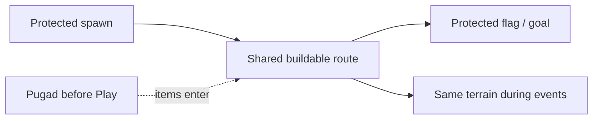

# Tilaok! Stage and Placement Specification

**Status:** pre-production contract with a verified P03 graybox implementation record (2026-10-13). `GDD.md` remains the source of truth when this document conflicts with it. The implementation is diagnostic geometry and reusable contracts, not production art or the complete placement/gameplay systems.

## Purpose

The stage must support the full **Pugad → Place → Play** loop across a persistent 12-round match. It begins as a readable race course, then becomes shared player-built terrain that helps and harms later rounds and events.

The design allows a stage to become unsolvable. Players are responsible for the risks created through placement. The base geometry, spawn safety, and Karera goal must remain usable.

## Stage zones

| Zone | Purpose | Placement and cleanup rule |
|---|---|---|
| Spawn zone | Safe entry area at the left side of the stage. | Base geometry is indestructible. No player item may occupy its protected clearance. |
| Karera route | The ordinary route between spawn and flag. | It may become difficult or blocked through player choices; it is not guaranteed solvable. |
| Goal zone | Flag platform and nearby arrival clearance during Karera. | Base geometry and flag are indestructible. No placed solid may occupy protected goal clearance. |
| Pugad zone | Egg-selection area used before placement. | Must not remain as a Play-phase obstruction. Exact location is a level-layout decision. |
| Buildable zone | Shared area where player items can persist. | Subject to grid, world-bound, collision, and protected-zone validation. |
| Event play area | The same shared stage while the flag is hidden in standalone event rounds. | Player-built geometry remains active unless an item contract states otherwise. |
| World bounds | Visible stage limits and out-of-bounds recovery limits. | Every item defines its own bounded behavior; no transient may remain unreachable indefinitely. |

## Base-stage requirements

The initial hand-built stage includes a solid floor, left spawn, right flag, and a small number of base platforms so Round 1 is playable before any construction.

Base-stage pieces, the floor, spawn, and flag are indestructible. They are not removable by Walis Cleanup or later demolition items. Base platforms do **not** satisfy Kangaroo Rising wave: only player-built solid geometry above the selected line qualifies.

## Wall contact and upward support are distinct

The approved wall-slide/wall-jump extension is Should scope; it is implemented with an explicit per-surface `wall_movement_eligibility` separate from wave eligibility, and automated checks confirm wall contact never writes support or Rising-wave eligibility ([evidence](evidence/p02-wall/README.md)). Actual contact with an eligible solid side may enable sliding or a wall jump, but side contact is never grounded/upward support. Do not record it as a `SupportContact`, set support provenance from it, or count it for Rising wave. Side normals, one-way platform sides/undersides, triggers, player bodies and arena containment boundaries are ineligible. Moving solid sides can qualify for wall movement only while actual contact remains valid; that does not make them upward support. The unchanged Rising-wave rule still requires actual eligible upward contact on player-built geometry above the line. The extension and regression contract are in [PRD REQ-MOVE-004](PRD.md#req-move-004--slide-on-eligible-walls-and-kick-away-with-a-fresh-jump-press) and [PHASETASK P02-T15–T22](PHASETASK.md#p02-wall-movement-extension--approved-unimplemented-should-scope).

P03's verified base route must remain traversable without wall movement. Future route trials must verify that requirement and that maximum kicks/launches remain within visible containment and camera framing. New shortcuts may be intentional; leaving bounds, bypassing immutable protection, or breaking an event contract is not.

The graybox below supplies provisional geometry coupled to PROTOTYPE_DEFAULTS.md. P03 verified the base route with Godot collision and the measured P02 controller; final art scale and player feel remain unverified.

## Placement phases

### Pugad

- Eggs show their contained item before selection.
- Egg claims are simultaneous. One egg can have one owner.
- The team will tune egg count, selection time, and unclaimed-egg handling later.

### Place

- Each player has a visible pointer and a green/red placement ghost.
- The player can move, rotate where the item contract allows it, and confirm.
- Normal items are inactive during Place.
- Walis Cleanup is the sole exception: confirmation performs its one-shot construction edit during Place and never becomes a Play-phase hazard.
- A timed-out item auto-places only if its current preview is valid; otherwise it is discarded.

### Atomic placement resolution

All submissions in a Place phase resolve from the same stage snapshot:

1. Gather confirmed placements and cleanup previews.
2. Resolve each Walis Cleanup target set from that snapshot.
3. Reject invalid placements. *Superseded 2026-10-14 (Jorge):* conflicting placements are no longer rejected as a set — the first player to confirm claims the cells (first come, first served); later players cannot confirm over them and edits resolve in confirmation order (see GDD construction rules).
4. Commit the remaining valid edits together.
5. Start Play with the committed stage.

Intentional solid-and-trigger overlap is allowed only when the trigger's active region remains visible and understandable.

## Placement validity

A placement is invalid when it would:

- exceed the item’s world bounds;
- overlap a living player’s protected body clearance;
- place a solid within protected spawn or goal clearance;
- conflict with another newly placed solid in the same atomic placement set;
- violate that item’s own footprint, rotation, or protected-clearance contract.

An item may be difficult, dangerous, or strategically unhelpful and still be valid. The game does not promise that a committed layout leaves a path to the goal or to an event objective.

## Persistent terrain and reset

- Committed player items persist into later rounds unless explicitly removed.
- At every Play start, placed moving items reset to their defined start position, direction, phase, and activation grace.
- Projectiles, temporary effects, bubbles, captures, and timers clear at round end, restart, owner removal, or as their item contract requires.
- Removing support must not crush or permanently pin a player. An unsupported moving item returns to its defined safe start or is removed as specified by its item contract.
- Removed player items remain removed; they do not reappear on the next round reset.

## Kangaroo Rising wave and player-built elevation

Rising wave selects one world-space band at equal probability: middle-low at **768 wu**, middle at **576 wu**, or middle-high at **384 wu** on the current 2048×1024-wu stage. The line is never floor-level, ceiling-level, or camera-relative. These are fixed provisional P11 defaults, not final balance values.

At evaluation, a chicken passes only while its actual current upward support is **eligible player-built solid geometry**, with feet `y <= selected_line_y + 1 wu` (numerical tolerance). Base-stage platforms, jumping through the line, bubble capture, stale support, and airborne states do not qualify. The support must remain live and current after same-step removals; the builder's seat does not restrict who may use it.

The game does not reroll a wave that no player can survive. Building useful elevation is a strategic responsibility shared across the match. This makes vertical construction, cleanup, and the preservation of elevated supports meaningful decisions.

## Visual and accessibility requirements

- Placement state must use a second cue besides colour: outline, icon, texture, or label for valid/invalid previews and protected zones.
- Placement ghosts must show footprint, rotation, and any separate trigger/effect region relevant to the item.
- Pointer identity uses each player’s number/shape marker as well as chicken colour.
- At minimum zoom, players must distinguish solid geometry, hazards, movable items, and the Kangaroo target line.

## Decisions still dependent on team implementation

Production artwork and later tuning remain open; the following first graybox values are implemented defaults rather than unresolved prototype choices:

- player collision width, height, jump height, movement speed, and logical tile size;
- exact base-stage drawing, Pugad location, flag clearance, camera size, and world bounds;
- exact protected-clearance dimensions around players, spawn, and goal;
- actual item footprints, support strength, and world-bound behavior;
- tuning for egg count, selection/placement time, and item cap.

## Verification links

See the implemented layout/support handoff below and the coupled movement model in [PROTOTYPE_DEFAULTS.md](PROTOTYPE_DEFAULTS.md).

The P03 graybox is reachable from the foundation harness. Pugad, atomic placement, cleanup, production items, Rising-wave scheduling, scoring, and match persistence remain separate future checks; this slice does not implement them. See [PLAYTEST.md](PLAYTEST.md) for the P03 procedures and the remaining later-system checks.

## Prototype graybox — implemented geometry and measured route

**P — PROTOTYPE DEFAULT.** x points right, y down. Bounds below are tile edges, right/bottom exclusive. One tile = 32 world units (wu); player clearance is 1×2 tiles, collider 24×48 wu. All base pieces are indestructible solid rectangles. These dimensions do not lock production art.

| Element | Tile coordinates | World dimensions / purpose |
|---|---|---|
| Arena | x 0–32, y 0–16 | 1024×512 wu, fixed visible containment |
| Solid floor | x 0–32, y 15–16 | top y=480 wu, continuous |
| Spawn feet | (3,15) | (96,480) wu; all players overlap, bodies pass through |
| Protected spawn | x 0–5, y 11–15 | no item footprint, sweep or effect |
| Base A | x 6–10, y 13–15 | top 416 wu; 4-tile-wide plinth |
| Base B | x 12–16, y 11–12 | top 352 wu; 4-tile ledge |
| Base C | x 18–22, y 13–15 | top 416 wu; second plinth |
| Base D | x 24–28, y 11–12 | top 352 wu; final raised ledge |
| Optional upper E | x 18–20, y 9–10 | top 288 wu; 2-tile landing, bypasses C |
| Goal platform | x 28–32, y 12–15 | top 384 wu |
| Flag trigger | x 30–31, y 10–12 | touch alive; captive must first be released |
| Protected goal | x 28–32, y 9–15 | no new footprint/sweep/effect; protected when flag hidden |
| Build region | x 5–28, y 3–15 | reject base/protected overlap and out-of-bounds geometry |
| Player build clearance | collider expanded 4 wu each side | additional protected body region |
| Side/ceiling containment | inner edges x=0, x=1024, y=0 | visible barriers, launches cannot crush/escape |
| Pugad | screen-space panel | not implemented in P03; the diagnostic HUD and previews are fixtures only |

**P03 route result — 2026-10-13:** the real `ChickenController` traversed floor → A → B → C → D → goal with Godot collision, including head/body clearance, takeoff, landing, braking and visible containment. The scene uses the controller's center origin: shared spawn feet `(96,480)` convert to center `(96,456)` for its 48-wu collider, so the chicken begins with its feet on the floor top instead of inside it. The optional upper E shortcut is omitted. See [P03 route assertions](evidence/p03/2026-10-13_p03_tests.txt) and [rendered arena capture](evidence/p03/2026-10-13_interactive_harness_1080p.png). No movement retune or geometry change was needed.

The original paper-route estimate (before the P03 collision trial) was: floor → A (+64 wu) → B (+64) → C (−64) → D (+64) → goal (−32). A→B and C→D have 64 wu gaps; the estimated 104-wu center displacement is below the calculated 134.1-wu ideal reach. The actual P03 collision trial now supersedes the earlier note that landing/braking needed physical verification.

Optional B→E has another 64 wu gap/rise. E→D crosses 128 wu while dropping 64 wu: ideal airtime ≈0.676 s and displacement ≈189 wu, versus 168 wu center travel with 20 wu margins. It bypasses C but needs a narrower landing. This is an advanced shortcut candidate, not a verified collision-safe route. Test full-body sweep and overhead clearance.

The floor catches mistakes but is slower than useful platforming: A/C interrupt ground running, dropping down loses elevation, and the flag platform is 96 wu above the floor. Construction can bridge gaps, widen landings, offer new shortcuts or obstruct rivals. Base terrain remains traversable on paper while Rising wave requires player-built elevation. Construction-only three/four-player rounds may all finish and award zero under the current rule; that is expected learning-slice behavior, not balanced long-term competition.

| Camera key | P starting value | Test/range |
|---|---|---|
| `virtual_size` / top HUD reservation | 1280×720 logical pixels / 64 pixels | Letterbox prototype to this aspect; no extra world on wider displays |
| `padding_wu` | 64 wu on all sides of targets | 48–80 wu after separation tests |
| `zoom_min`, `zoom_max` | 1.0, 1.4 | Keep minimum large enough for hazard readability; tune max 1.2–1.5 |
| `world_view_bounds` | x −64…1088, y −64…576 wu | neutral backdrop outside stage; center clamped by viewport extent |
| `ease_seconds` | 0.20 s nominal | 0.15–0.30 s; visibility overrides smoothing |

Start centered over the full arena at zoom 1.0 below the HUD. Padded arena =1152×640 wu, fitting the 1280×656 gameplay region. At 1080p/minimum zoom, a tile projects to 48 pixels and the body to 36×72 pixels. These are calculations, not final-art readability measurements. HUD text/markers remain screen-sized. Play frames live unfinished players; Place frames unconfirmed pointers with their item extents; empty target sets hold the last safe framing through results. Zoom out immediately enough to contain a fast launch, ease inward only if all targets stay visible. Build ceiling y=96 wu prevents high construction expanding the world and shrinking everyone.

**P03 camera result — 2026-10-13:** Play targets include each live body and identity badge; secured/eliminated targets drop individually. Place targets include each unconfirmed pointer's rotated preview extents; confirmed pointers drop individually. Identity badges use stable per-seat anchors so actor movement no longer changes their vertical bounds based on proximity. A live easing regression also found and fixed a second HUD reservation being subtracted from the already-adjusted camera position each frame; the camera now eases the camera center directly and applies HUD compensation only when fitting the target. Tests cover movement across the former 80-wu pair-separation boundary, the HUD easing path, 2/3/4 targets, opposite-corner extents, the highest legal build-region preview (y=96), and a real controller launched at the 900-wu/s upward cap. At 1080p, the rendered pair-separation reproduction measured 0.033 wu vertical camera change between 78- and 82-wu separation after settling. See the [camera jitter regression record](evidence/p03/2026-10-13_camera_jitter_fix.md), including screenshots and the earlier off-screen drift measurement. Rendered Play/Place captures are 1920×1080 at zoom 1.0. A 1920×800 window preserved the 1280×720 logical view (1422×800 game image), so extra window width does not reveal additional world. Captures and performance data are linked from [P03 verification](evidence/p03/2026-10-13_p03_verification.md). The graybox tests are not late-game stress or final-art readability evidence.

Shared spawn has simultaneous input unlock, no slot-based x offset or physical pushing. Fan number/shape labels with leader lines until chickens separate. Lagsanay keeps its documented opening head start. Prototype baseline shake is off. Change geometry/camera only after testing maximum separation, topmost construction and launch trajectories with all supported player counts.

## Rising-wave eligibility handoff

**C — CURRENT CONTRACT:** standing on player-built solid geometry above the line; any player's construction helps; base terrain does not qualify; impossible waves are not rerolled. **P — PROTOTYPE DEFAULT:** represent this through `wave_support_eligible` on each authored surface plus immutable `player_built` provenance and actual supporting contact. Do not derive eligibility from an arbitrary engine node type or current scoring owner.

| Candidate | Recommendation | Main drawback |
|---|---|---|
| Any collision surface | Reject | Includes walls/triggers/effects and violates provenance |
| Any player-built standable surface | Player-facing rule | Needs a visible distinction between constructed platforms and effects |
| Explicit eligible property plus contact | Internal rule | Each surface needs review/metadata; missing metadata must fail content validation |

Player wording: **Stand above the wave line on a built platform. Anyone's platform counts.** Eligible upward faces share a platform-edge pattern; wave telegraph adds a non-color support symbol above the line. Launch faces/base terrain/effects must not display that pattern. Failure gives one reason: no support, base surface, ineligible surface, or feet below line. A support symbol never means immunity to its hazard. P03 implements diagnostic labels/reasons and stable surface identity; it does not add a player-facing event HUD or mark fixture content as enabled.

| Surface/state | Yes/no/conditional | Requirement |
|---|---|---|
| Kaing Stack | Yes | Actual upward support above line |
| Tulay, including one-way | Yes | Landed on upward strip; not rising through underside |
| Spring launching | No | Launch removed supporting contact |
| Spring genuinely supported | Conditional | Separate safe eligible face carrying feet; no launch this evaluation |
| Moving platform | Conditional | Eligible authored platform; relative contact valid at evaluated position |
| Safe solid hazard part | Conditional | Clearly marked safe supporting face; lethal contact elsewhere still wins |
| Crumbling platform | Yes before collapse; no after | Supporting face still exists at evaluation |
| Base-stage floor/platform | No | Height cannot substitute for player-built provenance |
| Another chicken | No | Pass-through body is not a platform |
| Bubble/capture | No | Floating/capture is not grounded contact |
| Projectile | No | Collider is not a constructed platform |
| Temporary rideable object | Conditional | Explicit authored eligible platform child with player-built provenance and visible tell; arbitrary effects never count |
| Side-wall contact | No | Side normal is not support |
| Coyote-time state | No | Jump permission is not contact |
| Airborne crossing | No | Feet require support at evaluation |

Standable means an upward normal within 45° of vertical with collision actually carrying/blocking downward foot motion; v1 tops are horizontal. Store current supporting surface/contact point, not just a stale grounded boolean. Moving supports use relative motion. Sensor proximity alone is insufficient. The P03 tracker records slide contacts after controller movement, then evaluates the same physics step after support invalidation; removal invalidates registered contacts before queued node deletion. Prototype contact-height and wave-height tolerances are 1 wu each, with zero gameplay-time grace. These values remain subject to future Kangaroo playtesting.

Check feet/contact y, never head/sprite center. Above means smaller y. The numerical tolerance in PROTOTYPE_DEFAULTS allows `feet_y <= line_y + epsilon` to treat numerical equality consistently; it is not a visible grace band or grace duration. No coyote/buffer allowance applies. Provenance follows the placed construction and explicitly authored platform children, not ownership reassignment. Legal floating structures qualify without a structural-attachment simulation; accessibility of their elevation is the builders' responsibility.

Order: finish movement/platform motion and support destruction for the physics step; invalidate destroyed support; compare recorded hazard time to command evaluation; evaluate due commands and terminal events in one deterministic batch; commit at most one terminal outcome per player; resolve Main-Challenge placements. Same-step destroyed support is absent; a moving support uses its final current contact height. A comparable direct hazard takes terminal precedence only when its recorded time is strictly earlier than command evaluation. An exact tie, missing comparison, or incomparable time resolves as command failure, without Patibong credit for that failure; callback order cannot break the tie. Simultaneous final outcomes still use Last Cluck placement ordering.

**Stacked rounds (P12 owner decision, 2026-10-15; appended, no existing rule changed).** The same-step order above also governs Karera + Lagsanay, Karera + Kangaroo and Kangaroo + Lagsanay. The batch for one physics step is: finalise movement/support → snapshot goal overlaps, tag contacts and hazard records → each active controller proposes terminal outcomes against the same frozen live set → merge in stable order (recorded time → cause rank command failure < taya timeout < direct trap, incomparable-time trap last → seat) → one commit per player → derived effects (taya transfer/re-pick, placement, round end). A secured finisher is out of command, tag and hazard eligibility from the commit onward; same-step goals commit before the tag pass. The approved rows (U1–U12) and their scenarios are in [the P12 decision table](evidence/p12/p12_terminal_order_decision_table.md).

P11 automated evidence checks current player-built provenance, base/ineligible/stale/below-line failures, support removal, same-step contact refresh, all three selected lines, the 1-wu boundary, and wave drain. The linked P03 103-check support suite covers real moving contact, the complete support-state table and same-step destruction; see [P11 verification](evidence/p11/README.md). Human explanation/playability and balance review remain open. P03's older sample lines y=384/320/256 wu are movement/support fixture values, not P11 event bands. Increase numerical tolerance only for reproduced contact instability. Changing eligibility requires updated player-facing cues and rule review. Do not hide the deliberate consequence of failing to build useful elevation.

## P04 construction seeds — implemented results (2026-10-13)

**C/P — implemented and verified with synthetic input; not enabled for release.** Evidence: [P04 verification index](evidence/p04/2026-10-13_p04_verification.md).

| Surface | Footprint / collision | Measured support result |
|---|---|---|
| Kaing 1×1, 2×3, rotated 3×2 | One SOLID equal to the footprint (32×32, 64×96, 96×64 wu), no trigger | Chicken stands with feet y=255.98 on a y=256 top; `player_built`, `ELIGIBLE`, qualifies at the line; side contact is never recorded as support; head stops at the underside |
| Tulay 4×1 | 128×32 wu footprint reservation; exactly one one-way strip 128×4 wu at its top; no solid underside or sides | Lands from above (feet 255.98 on a y=256 top, 415.98 on a y=416 top); rising through reports `no support`; a body overlapping strip height walks through the side; five fall-cap drops (sampled peak 878.9 wu/s) all land on the strip within 1 wu of y=384 |
| Defined but disabled | Kaing 1×3 column and rotated 3×1, Tulay 3×1 and 5×1 | Geometry and standing verified under a capture-only tuning override; placement rejects `variant_disabled` by default |
| Gated vertical Tulay | 1×4 footprint, strip on the right edge, rightward normal | Geometry only; never driven by the controller; stays disabled behind `item_tulay_vertical_enabled` |

Placement is validated against bounds, protected spawn/goal, build region, base geometry, 4 wu player clearance, other footprints, the 48-piece cap, enabled variants and documented rotations. Only footprints occupy cells; sweep, lane and effect regions never do. Removal invalidates registered support and unregisters the construction before the node is freed. Kaing solid sides declare `wall_movement_eligibility` ELIGIBLE and Tulay declares INELIGIBLE (one-way shapes never qualify); the metadata was checked with the wall extension's own `WallContactProbe` (Kaing side found, Tulay side not found). The extension itself is enabled by default (core movement, owner decision 2026-10-13). Item Lab placement is immediate and lab-only; the atomic resolver in this document remains a P05 task.

## P10 first-batch results — implemented (2026-10-14)

**C/P — implemented and verified with synthetic input; not enabled for release.** Evidence: [P10 verification index](evidence/p10/2026-10-14_p10_verification.md).

| Surface/state | Result |
|---|---|
| Spring launching / resting on its face | Face reports `ineligible surface`; body is declared wave-support INELIGIBLE (fail closed). The conditional "separate safe face" row is a known limit. |
| Launcher, Parol posts, bubble pot | Solid, wave-support INELIGIBLE, wall INELIGIBLE. |
| Trumpo rail | No solid; its sweep occupies the whole rail footprint; the top is a swept sensor, never support. |
| Projectile, bubble, captive | Never support; never occupy cells; counted by `TransientBudget` (16/2 per emitter, 4/1 per emitter/1 per player). |
| Walis | One-shot edit with no footprint; targets come from the Place snapshot (`CleanupTargetResolver`), only earlier-round, removable, non-protected pieces; one union per resolution; removal invalidates support before the node is freed. |

Placement notes: a variant may reserve only part of its footprint (`occupied_cells`: Parol reserves its two posts, so solids may sit between them and occlude the beam). Lanes, beams and bubble paths declare `blockable`: immutable base geometry may clip them (they are shown to their first blocker) but protected spawn/goal and the build region still reject them. Order inside one physics step: movers/timers advance in stable item-ID order; lethal contacts resolve by recorded time, item ID, then seat with one terminal outcome per player (handed to the race ledger during Karera); captures and carries run for survivors; spring launches apply last.

## Tutorial stage layout — 2026-10-14

**C/P — implemented and verified with synthetic input; guided copy is PLACEHOLDER.** Evidence: [tutorial evidence index](evidence/tutorial/README.md).

**Data.** `ArenaLayout` (`scripts/stage/arena_layout.gd`, surfaces in `arena_surface_layout.gd`) is a Resource in tiles (fractions allowed). `ArenaDefinition.new(tuning, layout)` builds from it; `layout == null` keeps the literal default stage below untouched, and `ArenaLayout.make_default()` reproduces that stage exactly (a signature test enforces parity). `P03StageRoom.arena_layout` is set by `GameFlow` once, before the room enters the tree. Containment walls and the ceiling are always generated from the tuned arena size.

**One map per match.** The layout is chosen when a match room is created and never changes. Karera, Lagsanay and sudden-death rounds of that match all play on that stage plus everything built; no mode swaps or alters it. Skipping or replaying the tutorial mid-match does not change the stage. The next match starts on the default layout unless the tutorial is replayed. On the lifecycle route a Replay or Return to Lobby from a tutorial-stage room builds a fresh room (the room hands back to `GameFlow`), so the stage is never carried into the next match.

**Tutorial stage** (`tilaok!/data/stage/tutorial_arena_layout.tres`, id `tutorial`). Floor, Base A–D, spawn, protected spawn and the build region are identical to the default stage; the base route still reaches Base D with no building and no wall movement. Only the goal changes:

| Element | Default | Tutorial |
|---|---|---|
| Goal column | x 28–32, y 12–15 tiles (top 768 wu), wall-eligible | x 28–32, y 8–15 tiles plus a half-tile cap (`arena.goal_cap`, top **480 wu**), **wall-INELIGIBLE** on every side |
| Flag trigger | 30–31 x 10–12 tiles | 30–31 x 5.5–7.5 tiles (resting on the cap; flag is 7.5 tiles above the floor) |
| Protected goal | 28–32 x 9–15 | 28–32 x 4.5–15 |
| BUILD HERE zone | none | tiles 24–28 x 8–11 (airspace above Base D, flush with the ledge face), inside the build region and clear of protected zones and base geometry |

**Gate proof.** Jump apex is 192 wu (held jump), so the highest standable no-build height is Base B/D top 704 − 192 = **512 wu** (feet). The ledge top is 480 wu: **31.94 wu short** in the measured search. Wall kicks off Base A–D rise 144 wu from a contact window below the platform top and cannot chain; glide, wall slide and sneak cap descent or shrink the body and add no height; the ledge sides are ineligible. Why 480 and not a tile line: a 1x1 adds 64 wu, so no integer-tile ledge is both unreachable without a piece and reachable with a 1x1 with margin on both sides.

Real-physics results with the real `ChickenController` (`tests/run_tutorial_gate_tests.gd`, Godot 4.7.2, `--fixed-fps 60`): the unchanged P03 route reaches Base D on the tutorial stage and does not reach the flag; a 1,860-attempt scripted search (every base platform, 3 run directions x 5 jump delays x 2 hold lengths x 2 pulse patterns, glide held, repeated-press kicks) never reached the flag and peaked at feet y=511.94. Per allowed piece, the placements fully inside the zone that let the policy family reach the flag: Kaing 1x1 7 of 12, Kaing 2x3 6 of 7 (upright and turned), Tulay 4x1 3 of 3; five wrong placements (floor, Base A, above Base B, beside Base C, under Base D) did not reach. Intended single-piece answers: Kaing 1x1 at cell (27, 9); Kaing 2x3 turned to 3x2 at (25, 9); Tulay 4x1 at (24, 9). **A scripted search is strong evidence, not a mathematical proof**; Tulay at row 8 (top 512) works only by about 0.06 wu and should not be taught. Re-run the gate tests on any movement or geometry change.

The default base route rule is unchanged: normal matches use the default stage, `arena_geometry_signature()` is unchanged, and the P03 route test still passes.
