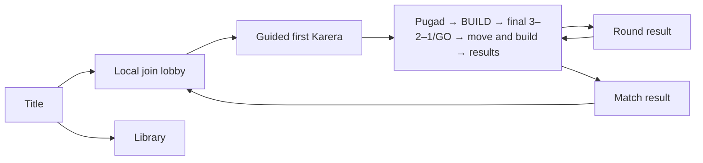

# Tilaok! UI, Accessibility, and Tutorial Specification

**Current onboarding (2026-10-25):** normal play is Lobby → Pugad → shared BUILD (up to 10 s) → final 3–2–1/GO → active play/build → results. Teach movement from each player's assigned-device HUD hints; the coach never merges multiple players' keys into one glyph string. The same one item can be placed inertly during BUILD or saved for a two-second live build. BUILD expiry starts play directly; GET READY is only the pause-resume countdown. Skip/replay stay session-only. Novice validation remains open.

## Experience goals

- A new local player understands how to join, move, jump, select an egg, place an item, and finish a Karera round without reading a long rules page.
- Every player can identify their chicken without relying on colour alone.
- A spectator can identify the current phase, objective, leader, event, and winner at a glance.
- Event prompts remain understandable at minimum camera zoom and during a crowded, persistent stage.

## Screen flow

| Screen | Required content | Primary actions |
|---|---|---|
| Title | Game title, start-local-match option, Library, settings, clear build/version label during development. | Start, Library, settings, back/quit. |
| Library | Browse enabled items, events, scoring, controls, and accessibility help outside an active match. | Choose category, inspect animated entry, back. |
| Local join lobby | Two-to-four player join slots, controller/keyboard prompt, chicken colour plus number/shape marker, ready state. | Join, select permitted identifier, ready, leave. |
| Tutorial | Guided first match with one action-aware instruction at a time. Teaches movement, Pugad, shared BUILD, saved-item live building, the flag, results and contextual mode lessons. | Use each seat's own input hints; move, claim, prepare or save an item, race, and read results. |
| Pugad | Visible eggs and contained items, selection countdown, locked next-round Main Challenge/Twist announcement where applicable. | Move pointer/character, claim egg. |
| BUILD / active Play | Shared BUILD lasts up to 10 seconds. Confirmation places an inert item immediately; if all players place, only the unused wait is skipped before the final 3–2–1/GO. A saved item can be used in Play; aiming pauses that chicken, and confirming restores movement while a visible two-second job runs. | Move, jump, toggle build, aim, rotate where supported, confirm or cancel. |
| Developer Place route | Separate legacy/test phase, not part of normal onboarding. | Follow the route-specific test controls. |
| Play | Phase/objective display, timer where applicable, score, player identity markers, event and item tells. | Run and jump baseline; optional sneak, glide and wall slide/jump are enabled in current tuning. |
| Round result | Finishes/eliminations, awarded points, current match total, clear winner or no-score explanation. | Continue when all players are ready or after timeout. |
| Match result | Exactly one winner, each original participant's exact final score, ordinary or sudden-death outcome, and Last Cluck explanation when applicable. | Replay, Return to Lobby, Quit; all original participants freshly ready. Quit/whole-group leave require confirmation and cancel restores the prior state. |

## Persistent in-match information

The HUD shows only information needed to make a current decision:

- current round and Main Challenge;
- a visible **TWIST** label beneath the Main Challenge when a compatible event is stacked;
- score totals in eighth-point-capable display form where ties require it;
- time limit/countdown only when the active challenge uses one;
- each player’s number or shape marker in addition to colour;
- player state: alive, finished/secured, eliminated, or current taya;
- Kangaroo is a flag race with one sequential slipper challenge at a time; command failures directly eliminate through race results.
- Barya carrier marker when Barya is enabled;
- next-round event announcement during the preceding Pugad phase.

Do not expose technical IDs, collision shapes, or internal random seeds in the player-facing HUD.

## Library

The Library is available from the title screen, lobby, and pause/settings menu. It is the deliberate slow-reading space for information that would interrupt a Pugad or Place phase.

| Section | Contents |
|---|---|
| How to Play | Pugad → shared BUILD (place now or save item) → GO → move and build → results, local controls, safety checks, stage persistence, and match end. |
| Karera | Flag objective, Tapos, first-finisher Una, no second/third-place points, Bayani, Bawi, Barya, and too-easy/too-hard outcomes. |
| Lagsanay | Taya, passing, timer, eliminations, Last Cluck, and survival placement scoring (first eliminated in four-player play is fourth for zero placement points). |
| Kangaroo | Race to the flag, sequential Freeze/Rising/Hug challenges, race results and secured finishers. |
| Items | Name, looping animation, grid/size variants, what it does, placement preview, tell, counterplay, and applicable event behavior. |
| Accessibility | Player markers, colour-independent tells, screen-shake settings, and audio/visual cue policy. |

The Library displays only enabled release content by default. Backlog entries can be visible only in a clearly marked development/reference mode; they must never imply that an unimplemented item is playable.

## Pugad and placement feedback

### Pugad

- Each egg visibly identifies its item and exact size variant through a short looping animation before a player claims it. It shows no name or description in the party flow.
- Egg ownership changes immediately and visibly on a successful simultaneous claim.
- A player whose claim loses receives a clear non-colour cue and can choose another available egg.
- Unclaimed-egg and timeout behavior must be explained before the first live Pugad phase.

### Placement

- The placement ghost distinguishes valid and invalid state through colour **and** outline/icon/texture.
- The preview shows the item footprint, rotation, size variant, and separate sweep, projectile lane, or effect radius where relevant.
- Projectile and rolling-shot items show a trajectory guide in Place: a straight lane to the first blocking solid, predicted ricochet segments, a terrain-following route, or a bounded sweep when the exact path depends on live physics.
- A rejected placement explains the actionable cause: protected zone, player clearance, world bound, solid conflict, or item-specific restriction.
- Walis Cleanup previews its exact target set and protected exclusions before confirmation.
- The transition to Play gives a short readable activation grace; no item should cause a first-frame surprise.

### Live-build keyboard and gamepad controls — October 23, 2026

Keyboard layouts keep each player's controls in a familiar cluster: K1 uses **Q** to toggle, **WASD** to aim, **E** to rotate, **R** to place and **F** to close; K2 uses **[**, the **arrow keys**, **Right Shift**, **Enter** and **Backspace**; K3 uses **-**, **IJKL**, **P**, **O** and **U**; K4 uses **Num +**, **numpad 8/4/2/6**, **Num 5**, **Num 0** and **Num .** in the same order. The chicken pauses during aiming and resumes when the preview is confirmed or closed. K1 Space remains an alternate place key. On a gamepad, the West/X face button rotates the preview and RB remains an alternate. The live HUD repeats the active bindings. These build-mode bindings do not change ordinary movement/jump behavior outside build mode.

## Karera communication

- The flag is visible and clearly marks the objective.
- A Kangaroo finisher is secured and excluded from later slipper challenges.
- The post-first-finish countdown is visible to unfinished live runners.
- The round result explains Tapos, Una, Bayani, Bawi, Patibong, and Barya awards in plain language.
- When the too-easy or too-hard rule suppresses points, the result screen explicitly says why.

## Lagsanay communication

- The current taya has a clear body marker, countdown, and pass-back-immunity feedback.
- The opening frozen taya state has a visible countdown so every player understands why the taya cannot move or be hurt yet.
- **P08 current development implementation (scene-based since 2026-10-14):** the Play HUD names Lagsanay, shows the head-start or taya countdown, tags the taya's player number and shape, and marks that seat TAYA in its score row; a notice reports recently immune player identity/time. The DEBUG overlay adds the longer status (other contacts remain usable). An authored world-space marker repeats the taya identity over the chicken. The Round result screen explains outcomes, placement, direct Patibong/Bawi and the exact Last Cluck winner/tie rule. This is placeholder presentation, not the final UI design.
- Tagging uses an obvious contact effect independent of chicken body collision.
- Eliminations show placement order. If the final group is eliminated in the same physics tick, show **Last Cluck!** and the deterministic winner callout.
- Spectating players retain the cheer button and do not obscure active-player information. **Implemented (2026-10-15):** an eliminated or finished chicken presses its Rotate control (R / Right Shift / West) during Play; its own HUD row shows `CHEER!` for 1 s with a soft Crowd-bus sound; a 1 s per-seat cooldown applies; nothing in the simulation changes.

## Kangaroo communication

The giant background slipper is a non-colliding presenter. The scheduled P23 route uses a separate illustrated texture for each pose; the command card repeats the corresponding silhouette beside a command name and instruction. Every command needs all of these cues:

| Slipper pose | Command | Required cue |
|---|---|---|
| Top view with strap/footbed | Freeze | Illustrated slipper pose, distinct command icon/text, Freeze accent, distinct audio, timing ring. |
| Outsole view with tread | Rising wave | Illustrated slipper pose, distinct command icon/text, live water surface and final-height line, distinct audio, timing ring. |
| Side profile | Hug | Illustrated slipper pose, distinct command icon/text, compact current-contact links, distinct audio, timing ring. |

- Screen shake defaults to Full, with Reduced and Off available. The command remains legible without screen shake or colour.
- Rising shows its world-space target line before a slow rise. At response end, the current chicken hitbox bottom must clear the line with 1 wu tolerance; support is not required, and submersion during the rise is safe.
- Hug shows the response-end evaluation clearly. Any contact group passes, including pairs, groups and chains; isolated chickens fail. Hug may occur with two players and is skipped for a sole unfinished runner.
- Commands are independent equal-probability draws; repeats are allowed. Only one command may be active at a time.
- Freeze strikes lock movement, jump and build controls for 2 s. Gravity and hazards continue; the blue translucent body tint and compact frost accent clear on thaw. Current generated presentation assets still need human art/readability approval; see [P23 presentation evidence](evidence/p23_presentation/README.md).

## Tutorial sequence

The first match begins with a guided Karera. It teaches the normal live-build loop; it does not require a player to learn Lagsanay or Kangaroo before playing. The core route target is one short round (roughly 2–3 minutes, unvalidated); contextual lessons may recur in later rounds if a seat misses an action.

1. **Welcome:** identify the player’s chicken number/shape and explain the local join display.
2. **Move and jump:** reach short, safe markers on the base stage.
3. **Pugad:** point out that each egg shows the item inside; claim one egg.
4. **Move and jump:** during active play, track each seat's actual run, jump and upward movement. Offer optional sneak, glide and wall movement tips. Terminal or round end releases the prompt without recording a successful lesson.
5. **BUILD and live building:** explain one item per player per round, prepare-now versus save-for-play, inert preparation placement, camera behavior, validation and two-second live construction. A seat that used its item during BUILD is never asked to place it again that round. Leave an untried path replayable; do not block round progression.
6. **Karera and results:** teach the flag and persistent stage, then explain the actual score chart, total/target and award rows. Explain all-finish/no-finisher suppression and the eligible Barya exception. Reference help covers match target, round cap and tied-player sudden death.
7. **Later just-in-time prompts:** first Lagsanay teaches taya, head start, pass, unchanged countdown, trap danger and last-survivor scoring. First Kangaroo teaches the race, sequential commands, Freeze's lack of projectile immunity, Rising's final hitbox test, any-contact Hug and sole-runner behavior.
8. **Item clues:** on a later play with construction present, point out safe surfaces, hazard tells, moving hazards, bubble capture and footprint versus effect area. The Library holds full item details.

Tutorial prompts must be skippable after a player has completed them in the current session. A replayable rules/help page remains available from the lobby and pause/settings menu.

**Optional movement cues:** wall slide/jump, sneak and glide are enabled in current tuning. Keep them optional after basic movement and point to the current per-seat input hints. Tuning values remain provisional.

## Guided first match — action-aware onboarding

The coach reads room state and player input; it does not change normal match rules, scoring, timers, inventory or terminal outcomes. Session-only per-seat records cover movement/jump and whether each seat used its item during BUILD or active play. An untried lesson can return in later rounds. A terminal seat or ended round releases the current instruction without counting it as learned. Everyone completes movement plus both item-use paths before the session marks the guided match complete; Pause > Skip remains the escape. Rounds continue if a player misses a prompt, is eliminated, or chooses the other valid item path.

| Lesson | Trigger and action | Completion / recovery |
|---|---|---|
| Join and identity | Lobby; join and ready with the assigned device. | Existing lobby state; coach is display-only. |
| Move/jump | First active play; move and jump toward the next safe ledge. | Per-seat movement and jump are observed. Terminal/round end releases without marking success; retry in later play. |
| Pugad | Pugad; claim a visible egg. | Per-seat assignment, lost claim or timeout; choose again if available. |
| Prepare item | BUILD; confirm a valid preparation placement or save the item. | Track each seat's BUILD use; no live placement is required if the item was already spent. |
| Live build | Active play while the seat still owns its item; toggle, aim, confirm or cancel. | Per-seat item use; normal validation and job completion apply. Round end releases the lesson. |
| Karera/results | Active race, then Round result. | Round state; copy is selected from actual result data. |
| Lagsanay/Kangaroo | First occurrence of that Main Challenge or sudden-death Lagsanay. | Mode state/round end, never elapsed prompt display alone. Seen state is session-only. |
| Item clues | Later play with construction present. | Shown contextually; Library reference stays available. |

Normal rounds use shared BUILD for up to 10 seconds, with early completion when every seat places. Otherwise the timer continues; expiry starts play. BUILD confirmation places the item immediately as an inert piece. A saved item can be aimed during play; confirm restores movement while a two-second construction job runs, and hazards activate when it completes. BUILD's final 3–2–1 is part of that phase; there is no extra wait. The separate three-second GET READY is only for pause resume.

Skip is Pause > Skip tutorial; Replay is Library > How to Play. Both stay session-only. Replay clears per-seat learning and just-in-time state and creates a fresh reachable tutorial room. Live prompts remain display-only. Per-seat input hints stay under each player's score. Copy remains PLACEHOLDER pending human language/cultural review. No novice session is claimed; P13-T08 remains open.

## Just-in-time prompts — current route (PLACEHOLDER copy)

| Prompt | Shown when | Source |
|---|---|---|
| `lagsanay` | first Lagsanay Main or sudden death, until that mode ends | `tutorial_script.tres` step `lagsanay` |
| `kangaroo_poses` | Pugad before a scheduled Kangaroo Main | step `kangaroo_poses` |
| `kangaroo_supports` | BUILD before Kangaroo; Rising's final line does not require a platform | step `kangaroo_supports` |
| `kangaroo_misses` | Kangaroo Play; explains Hug contact groups and sole-runner behavior | step `kangaroo_misses` |

Each shows once per session and is never saved. Pause > Skip hides coach prompts; Library > How to Play > Replay clears them. Lagsanay and Kangaroo are standalone Main Challenges on the current route. Old P13 evidence covers scripted prompt/state checks only, not novice comprehension.
## Accessibility baseline

- Colour is never the sole identifier for chickens, teams, valid/invalid state, taya, Barya, or hazards.
- Use readable text, shape/icon, animation, and audio as redundant cues.
- Keep HUD text, target lines, and danger regions legible at minimum camera zoom.
- Provide independent volume controls for master, music, effects, and crowd audio if the final settings scope permits.
- Support gamepad-first local play and a documented shared-keyboard fallback.
- Avoid rapid flashing; Parol Pulse uses a brightness ramp and other cues rather than rapid flicker.
- Do not require a screen shake effect, fine colour distinction, or audio alone to react correctly.

## Results chart reading — 2026-10-15

Round and final results include a shared vertical score chart. Columns stay in seat order and retain each chicken's number and shape identifier. Read the horizontal guides from the zero baseline; the target guide marks the configured match target. Each stack segment is an exact integer eighth-point award and the adjacent legend names it with both a glyph and text. A neutral segment means the prior total has no award history available, not a newly invented award. A zero-score chicken stands on a neutral perch. The round breakdown and suppression reason remain readable outside the chart.

The final-results winner callout remains explicit in tied sudden death, even when tied leaders have equal-height bars. A round-12 winner below the target line remains below it. The independent Result reveal motion setting controls the reveal; changing Screen shake does not affect it. These are implementation notes, not evidence of novice comprehension. A human readability review and tutorial comprehension session remain open.

## Decisions still dependent on art and implementation

Provisional phase bindings, device/identity assignment, held-button policy and pause/reconnect now live in [PROTOTYPE_DEFAULTS.md](PROTOTYPE_DEFAULTS.md#3-input-and-local-competition). They are **PROTOTYPE — UNTESTED**. The list below concerns final choices and physical validation rather than permission to invent conflicting per-player input rules.

- final typography, language mix, icon set, and text copy;
- exact lobby navigation and keyboard-sharing constraints;
- pause behavior in local multiplayer;
- final settings list and audio-control granularity;
- exact minimum zoom, safe-area dimensions, and device-resolution targets (STILL OPEN: NLB-P10 implements the 5 % inset, 44 dp floor and 16 px text as PROPOSALS only; they stay unmeasured until the T03 sessions on real Android hardware).

## Verification links

`PLAYTEST.md` contains the required 2/3/4-player, device, minimum-zoom Parol, Kangaroo accessibility, tutorial, and event-stack checks. P08 taya/head-start/pass immunity and P09 live match-end, sudden-death, result and restart behavior passed synthetic engineering checks. P11's standalone command cues and event checks also have synthetic engineering evidence; see [P08 evidence](evidence/p08/README.md), [P09 evidence](evidence/p09/README.md) and [P11 evidence](evidence/p11/README.md). The guided tutorial, final visual treatment, player comprehension/readability, physical-device validation and P13 product UI remain open.
**Current status (2026-10-25):** current onboarding uses the action-aware sequence above. P13 technical evidence is historical and does not establish novice comprehension. Human language/cultural review and a novice session remain open.
# Current Play readability amendment — 2026-10-23

Tutorial and Library content describes standalone Karera, standalone Lagsanay/Bomb-Taya, and standalone Kangaroo. It no longer teaches a mixed Twist route. Runtime timer tokens use `GameplayTuning`; current starting values are Pugad 15 s, Karera 120/30 s, Lagsanay 20/25/30 s, and Kangaroo 2/6/1.5 s with explicit acceleration floors. The Kangaroo guide identifies the race objective, sequential command cue and selected Rising target line. Values are provisional and do not claim balance approval.
