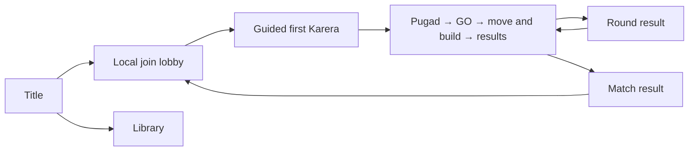

# Tilaok! UI, Accessibility, and Tutorial Specification

**Current onboarding (2026-10-22):** teach local join, Pugad selection, shared GO, movement while building, preview warnings, the two-second completion delay, obstruction rejection and cancellation. Phone/LAN help content is retired; historical NLB records are archived.

## Experience goals

- A new local player understands how to join, move, jump, select an egg, place an item, and finish a Karera round without reading a long rules page.
- Every player can identify their chicken without relying on colour alone.
- A spectator can identify the current phase, objective, leader, event, and winner at a glance.
- Event prompts remain understandable at minimum camera zoom and during a crowded, persistent stage.

## Screen flow

| Screen | Required content | Primary actions |
|---|---|---|
| Title | Game title, start-local-match option, Library, settings, clear build/version label during development. | Start, Library, settings, back/quit. |
| Library | Browse enabled items, events, scoring, controls, and accessibility help outside an active match. | Choose category, inspect animated entry, back. |
| Local join lobby | Two-to-four player join slots, controller/keyboard prompt, chicken colour plus number/shape marker, ready state. | Join, select permitted identifier, ready, leave. |
| Tutorial | Guided first Karera with one instruction at a time. | Move, jump, grab egg, place/rotate/confirm, reach flag. |
| Pugad | Visible eggs and contained items, selection countdown, locked next-round Main Challenge/Twist announcement where applicable. | Move pointer/character, claim egg. |
| GO / active Play | Shared 3-second GO; move while aiming a fixed build preview. It shows player number, shape, footprint, progress and time remaining. Completion takes 2.0 gameplay seconds; invalid obstruction rejects and keeps the item. | Move, jump, toggle build, aim, rotate, confirm or cancel. |
| Place | Shared stage, each player pointer, valid/invalid ghost, rotation prompt, countdown, protected-zone feedback. | Move, rotate where available, confirm. |
| Play | Phase/objective display, timer where applicable, score, player identity markers, event and item tells. | Run and jump baseline; wall slide/jump controls appear only if the approved Should extension is implemented, verified and selected for release. |
| Round result | Finishes/eliminations, awarded points, current match total, clear winner or no-score explanation. | Continue when all players are ready or after timeout. |
| Match result | Exactly one winner, each original participant's exact final score, ordinary or sudden-death outcome, and Last Cluck explanation when applicable. | Replay, Return to Lobby, Quit; all original participants freshly ready. Quit/whole-group leave require confirmation and cancel restores the prior state. |

## Persistent in-match information

The HUD shows only information needed to make a current decision:

- current round and Main Challenge;
- a visible **TWIST** label beneath the Main Challenge when a compatible event is stacked;
- score totals in eighth-point-capable display form where ties require it;
- time limit/countdown only when the active challenge uses one;
- each player’s number or shape marker in addition to colour;
- player state: alive, finished/secured, eliminated, or current taya;
- Kangaroo failure sequence: **KANG → GA → ROO**;
- Barya carrier marker when Barya is enabled;
- next-round event announcement during the preceding Pugad phase.

Do not expose technical IDs, collision shapes, or internal random seeds in the player-facing HUD.

## Library

The Library is available from the title screen, lobby, and pause/settings menu. It is the deliberate slow-reading space for information that would interrupt a Pugad or Place phase.

| Section | Contents |
|---|---|
| How to Play | Pugad → shared GO → move and build → results, local controls, safety checks, stage persistence, and match end. |
| Karera | Flag objective, Tapos, first-finisher Una, no second/third-place points, Bayani, Bawi, Barya, and too-easy/too-hard outcomes. |
| Lagsanay | Taya, passing, timer, eliminations, Last Cluck, and survival placement scoring (first eliminated in four-player play is fourth for zero placement points). |
| Kangaroo | Slipper poses, Freeze, Rising wave, Hug pairs, misses, Slipper Storm, and player-built wave supports. |
| Items | Name, looping animation, grid/size variants, what it does, placement preview, tell, counterplay, and applicable event behavior. |
| Accessibility | Player markers, colour-independent tells, screen-shake settings, and audio/visual cue policy. |

The Library displays only enabled release content by default. Backlog entries can be visible only in a clearly marked development/reference mode; they must never imply that an unimplemented item is playable.

## Pugad and placement feedback

### Pugad

- Each egg visibly identifies its item and exact size variant through a short looping animation before a player claims it. It shows no name or description in the party flow.
- Egg ownership changes immediately and visibly on a successful simultaneous claim.
- A player whose claim loses receives a clear non-colour cue and can choose another available egg.
- Unclaimed-egg and timeout behavior must be explained before the first live Pugad phase.

### Placement

- The placement ghost distinguishes valid and invalid state through colour **and** outline/icon/texture.
- The preview shows the item footprint, rotation, size variant, and separate sweep, projectile lane, or effect radius where relevant.
- Projectile and rolling-shot items show a trajectory guide in Place: a straight lane to the first blocking solid, predicted ricochet segments, a terrain-following route, or a bounded sweep when the exact path depends on live physics.
- A rejected placement explains the actionable cause: protected zone, player clearance, world bound, solid conflict, or item-specific restriction.
- Walis Cleanup previews its exact target set and protected exclusions before confirmation.
- The transition to Play gives a short readable activation grace; no item should cause a first-frame surprise.

## Karera communication

- The flag is visible and clearly marks the objective.
- A finisher receives a **secured** state marker in Karera + Lagsanay and Karera + Kangaroo stacks.
- The post-first-finish countdown is visible to unfinished live runners.
- The round result explains Tapos, Una, Bayani, Bawi, Patibong, and Barya awards in plain language.
- When the too-easy or too-hard rule suppresses points, the result screen explicitly says why.

## Lagsanay communication

- The current taya has a clear body marker, countdown, and pass-back-immunity feedback.
- The opening frozen taya state has a visible countdown so every player understands why the taya cannot move or be hurt yet.
- **P08 current development implementation (scene-based since 2026-10-14):** the Play HUD names Lagsanay, shows the head-start or taya countdown, tags the taya's player number and shape, and marks that seat TAYA in its score row; a notice reports recently immune player identity/time. The DEBUG overlay adds the longer status (other contacts remain usable). An authored world-space marker repeats the taya identity over the chicken. The Round result screen explains outcomes, placement, direct Patibong/Bawi and the exact Last Cluck winner/tie rule. This is placeholder presentation, not the final UI design.
- Tagging uses an obvious contact effect independent of chicken body collision.
- Eliminations show placement order. If the final group is eliminated in the same physics tick, show **Last Cluck!** and the deterministic winner callout.
- Spectating players retain the cheer button and do not obscure active-player information. **Implemented (2026-10-15):** an eliminated or finished chicken presses its Rotate control (R / Right Shift / West) during Play; its own HUD row shows `CHEER!` for 1 s with a soft Crowd-bus sound; a 1 s per-seat cooldown applies; nothing in the simulation changes.

## Kangaroo communication

The giant background slipper is a non-colliding presenter. Every command needs all of these cues:

| Slipper pose | Command | Required cue |
|---|---|---|
| Normal, sole down | Freeze | Freeze icon/text, distinct audio, timing ring. |
| Sole up/facing down | Rising wave | Wave icon/text, target line, distinct audio, timing ring. |
| Sideways | Hug | Pair icon/text, distinct audio, timing ring. |

- Screen shake has full, reduced, and off settings. The command remains legible without screen shake or colour.
- Rising wave shows its world-space target line before the wave rises. A player-built support above the line is required; base platforms do not qualify.
- Hug shows the evaluation moment clearly. Pairing is evaluated only at that instant, and each chicken can have one partner.
- A sideways slipper rerolls at two survivors; communicate the reroll before the next telegraph.
- During Slipper Storm, show the two active command requirements separately and retain the same pose/icon/audio cues. The display must make the two-command cap clear.

## Tutorial sequence

The first match begins with a guided Karera. It teaches the normal live-build loop; it does not require a player to learn Lagsanay or Kangaroo before playing.

1. **Welcome:** identify the player’s chicken number/shape and explain the local join display.
2. **Move and jump:** reach short, safe markers on the base stage.
3. **Pugad:** point out that each egg shows the item inside; claim one egg.
4. **Shared GO / build mode:** show that the chicken pauses while aiming, directional controls move the preview, and confirming starts a visible 2.0-second job after which movement resumes; explain the footprint warning and cancellation.
5. **Karera:** run, jump and reach the flag.
6. **Results:** explain Tapos and first-finisher Una with the actual Karera result; explain that second and third finishers get no rank bonus.
7. **Later just-in-time prompts:** before the first Lagsanay, explain taya, pass, timer, and last-survivor objective. Before the first Kangaroo, explain the three slipper poses, three misses, and player-built Rising wave supports.

Tutorial prompts must be skippable after a player has completed them in the current session. A replayable rules/help page remains available from the lobby and pause/settings menu.

**Future approved Should extension:** if wall movement is included before release, add a brief optional practice cue showing that wall contact slows descent and a fresh jump press kicks away. The cue must explain that holding jump does not repeat and that players must separate before kicking from the same wall again. Add the control to the Library and tutorial only after implementation and verification; no wall-movement tutorial, HUD, animation or sound currently exists. Human production owns any final animation/audio assets.

## Guided first match — live-build onboarding

The guided first match teaches Pugad → shared GO/build while moving → Karera. It uses the normal live-build route and a tutorial layout that makes a completed build useful for reaching the flag. Skip and replay are session-only.

| Step | Shown during | Advances when |
|---|---|---|
| 1 Welcome | Lobby | the match leaves the Lobby (number + shape of every seat; run/jump glyphs per device) |
| 2 Pugad | Pugad | a seat owns an egg or the timer assigns one (copy for claimed / lost / timeout; claim feedback wins over the Barya note, which repeats the claim key and timer — 2026-10-16) |
| 3 Shared GO / build | active race | a construction job completes or the round ends; teach the control lock while aiming, movement resuming after confirm, and the visible progress/footprint warning |
| 4 Karera | active race | the round ends |
| 5 Results | Round result | the next round starts; text selected from the real result (some / everyone / nobody); all-finish suppresses ordinary awards even with two players, while Barya still counts |
| Lagsanay | first Lagsanay or sudden death of a session | Lagsanay ends; shown once per session (only reachable on the lifecycle route today) |

Move/jump is taught before and during the first race. The scheduled Place route remains available as a developer fallback and is not part of normal onboarding.

Skip is a Pause menu entry ("Skip tutorial", shown only while the tutorial is active); Back is not used (P09 binds it to leave-confirm). Replay is the "Replay tutorial" entry on the Library How to Play page; it clears the session set. The coach box is display-only and sits where it does not cover the 64 px HUD or the Place strip. Copy lives in `tilaok!/data/ui/tutorial_script.tres` and is not culturally reviewed. The wall-slide practice cue is still a later Should extension. No human novice session has run: P13-T08 stays unchecked.

## Just-in-time prompts — implemented (2026-10-15, PLACEHOLDER copy)

| Prompt | Shown when | Source |
|---|---|---|
| `lagsanay` | the first Lagsanay Main round, or a Bomb-Taya Twist (Twist wording: the flag still wins); hands over after 12 s | `tutorial_script.tres` step `lagsanay`, variant `twist` |
| `kangaroo_poses` | the Pugad of a round that is, or precedes, a Kangaroo Main or Twist round | step `kangaroo_poses` |
| `kangaroo_supports` | the Place of that round (build up for the Rising wave) | step `kangaroo_supports` |
| `kangaroo_misses` | once Kangaroo commands run (KANG, GA, ROO; the third is out) | step `kangaroo_misses` |

Each shows once per session (`TutorialSession.seen_kangaroo_steps`, never saved); Pause > Skip tutorial hides all of them and Library > How to Play > Replay tutorial clears them. On a stacked round the taya prompt is shown first and hands over to the Kangaroo prompt. The guided first match keeps its Pugad / GO-build / Results steps; the Kangaroo prompt takes over during the event. Evidence: [P13 tutorial suite](evidence/p13/test_logs/run_p13_tutorial_tests.txt).

## Accessibility baseline

- Colour is never the sole identifier for chickens, teams, valid/invalid state, taya, Barya, or hazards.
- Use readable text, shape/icon, animation, and audio as redundant cues.
- Keep HUD text, target lines, and danger regions legible at minimum camera zoom.
- Provide independent volume controls for master, music, effects, and crowd audio if the final settings scope permits.
- Support gamepad-first local play and a documented shared-keyboard fallback.
- Avoid rapid flashing; Parol Pulse uses a brightness ramp and other cues rather than rapid flicker.
- Do not require a screen shake effect, fine colour distinction, or audio alone to react correctly.

## Results chart reading — 2026-10-15

Round and final results include a shared vertical score chart. Columns stay in seat order and retain each chicken's number and shape identifier. Read the horizontal guides from the zero baseline; the target guide marks the configured match target. Each stack segment is an exact integer eighth-point award and the adjacent legend names it with both a glyph and text. A neutral segment means the prior total has no award history available, not a newly invented award. A zero-score chicken stands on a neutral perch. The round breakdown and suppression reason remain readable outside the chart.

The final-results winner callout remains explicit in tied sudden death, even when tied leaders have equal-height bars. A round-12 winner below the target line remains below it. The independent Result reveal motion setting controls the reveal; changing Screen shake does not affect it. These are implementation notes, not evidence of novice comprehension. A human readability review and tutorial comprehension session remain open.

## Decisions still dependent on art and implementation

Provisional phase bindings, device/identity assignment, held-button policy and pause/reconnect now live in [PROTOTYPE_DEFAULTS.md](PROTOTYPE_DEFAULTS.md#3-input-and-local-competition). They are **PROTOTYPE — UNTESTED**. The list below concerns final choices and physical validation rather than permission to invent conflicting per-player input rules.

- final typography, language mix, icon set, and text copy;
- exact lobby navigation and keyboard-sharing constraints;
- pause behavior in local multiplayer;
- final settings list and audio-control granularity;
- exact minimum zoom, safe-area dimensions, and device-resolution targets (STILL OPEN: NLB-P10 implements the 5 % inset, 44 dp floor and 16 px text as PROPOSALS only; they stay unmeasured until the T03 sessions on real Android hardware).

## Verification links

`PLAYTEST.md` contains the required 2/3/4-player, device, minimum-zoom Parol, Kangaroo accessibility, tutorial, and event-stack checks. P08 taya/head-start/pass immunity and P09 live match-end, sudden-death, result and restart behavior passed synthetic engineering checks. P11's standalone command cues and event checks also have synthetic engineering evidence; see [P08 evidence](evidence/p08/README.md), [P09 evidence](evidence/p09/README.md) and [P11 evidence](evidence/p11/README.md). The guided tutorial, final visual treatment, player comprehension/readability, physical-device validation and P13 product UI remain open.
**Status (updated 2026-10-22):** the normal onboarding route teaches Pugad → shared GO/build while running → Karera → results. The guidance here defines what players must understand and operate; it does not prescribe final visual style. The UI shell inventory and P05/P06/P09 implementation details below are dated historical notes. The scheduled Place route is now a developer fallback. No human novice, spectator or QA session is claimed; related acceptance remains open (see [P13 evidence](evidence/p13/README.md)).
